# SQL → PySpark Fine-Tuning Pipeline: Master Project Documentation

**An offline, Apple-Silicon pipeline that LoRA-fine-tunes Qwen2.5-Coder-3B-Instruct to translate SQL into idiomatic PySpark DataFrame code.**

This is the single-file version of the guides in [docs/](docs/INDEX.md); each section links to the detailed guide.

---

## 📑 Table of Contents

1. [Executive Summary & Architecture](#1-executive-summary--architecture)
2. [Repository & File Structure](#2-repository--file-structure)
3. [Data Engineering & Synthetic Generation](#3-data-engineering--synthetic-generation)
4. [Spark Dual-Execution Verification](#4-spark-dual-execution-verification)
5. [Leakage-Free Dataset Splitting](#5-leakage-free-dataset-splitting)
6. [LoRA Fine-Tuning & Model Training](#6-lora-fine-tuning--model-training)
7. [Fusion, Dequantization & GGUF Quantization](#7-fusion-dequantization--gguf-quantization)
8. [Ollama Serving & Streamlit Web UI](#8-ollama-serving--streamlit-web-ui)
9. [Execution-Based Evaluation & Benchmarks](#9-execution-based-evaluation--benchmarks)
10. [Operations Runbook & Makefile Reference](#10-operations-runbook--makefile-reference)

---

## 1. Executive Summary & Architecture

The goal is a small local model that turns SQL into PySpark code that actually runs and returns the same result. The pipeline:
1. **Generates ~20k SQL/PySpark pairs** with a compositional generator (`sqlspec.py`, `generate_dataset.py`, and since v4 the stage-based `advanced.py` for long pipelines, advanced Spark SQL and nested data) that renders both sides from the same objects, so they agree by construction.
2. **Executes every pair in local Spark** (`verify_pairs.py`) and keeps only pairs whose column names, rows and ORDER BY sequence match: 20,068 of 20,105 v4 pairs pass.
3. **Splits by feature signature** (`convert_sql_pyspark.py`), so validation and test contain feature combinations that never occur in training.
4. **Fine-tunes Qwen2.5-Coder-3B-Instruct (4-bit MLX)** with LoRA on a base M2 (v4 from scratch: validation loss 0.389 → 0.018, ~5 h 15 min; v5 continued from v4: 0.030 → **0.012**, ~5 h 40 min).
5. **Exports a Q8_0 GGUF** served by Ollama behind a Streamlit UI.
6. **Scores models by executing their answers** on 62 hand-written queries over unseen tables (v3 95%, v4 94%, v5 90%, v2 90%, v1 6%), 25 hand-written v4-feature queries (v5 56%, v4 36%, v3 12%), 4 real-world production queries (all models 0/4) and a fixed 150-query test set (v5 128, v4 110, v3 105). `sql2pyspark:latest` = **v3** since 2026-09-26; v4 and v5 are available as `sql2pyspark:v4` / `:v5` but were not promoted.

### Architecture Diagram:

```mermaid
flowchart LR
    subgraph DataPrep [Data Preparation]
        Schemas[schemas.py] --> Gen[generate_dataset.py]
        HW[handwritten_pairs.py] --> Raw
        Gen --> Raw[raw_pairs/]
        Raw --> SparkCheck[verify_pairs.py<br/>Spark Dual Execution]
        SparkCheck --> Split[convert_sql_pyspark.py<br/>Signature Split]
        Split --> JSONL[data/*.jsonl]
    end

    subgraph TrainPhase [Training & Export]
        JSONL --> MLX[mlx_lm.lora<br/>lora_config.yaml]
        MLX --> Adapters[adapters/]
        Adapters --> Fuse[mlx_lm.fuse --dequantize]
        Fuse --> HF[sql2pyspark-hf/<br/>BF16]
        HF --> Llama[llama.cpp<br/>convert_hf_to_gguf.py]
        Llama --> GGUF[sql2pyspark.gguf<br/>Q8_0 3.3GB]
    end

    subgraph ServeEval [Serving & Validation]
        GGUF --> Modelfile[Modelfile]
        Modelfile --> Ollama[Ollama Server]
        Ollama <--> Streamlit[app.py<br/>Streamlit UI]
        Ollama <--> Eval[eval/evaluate.py<br/>Spark Scoring]
    end
```


Details: [docs/01-architecture-overview.md](docs/01-architecture-overview.md).

---

## 2. Repository & File Structure

```
Finetuning-LLM/
├── Makefile                      # Pipeline orchestration (`make help`)
├── Modelfile                     # Ollama model definition & system prompt
├── README.md                     # Overview, results table, known gaps
├── PROJECT_DOCUMENTATION.md      # This file
├── app.py                        # Streamlit web converter UI
├── requirements.txt              # Pinned dependencies
├── pyrefly.toml                  # Editor type-checker config (project venv)
├── sql2pyspark.gguf              # 3.29 GB Q8_0 GGUF of the last export (v4); Ollama keeps its own copies
├── docker-compose.yml, docker/, .dockerignore   # Docker: app, tools (Spark data/eval), ollama
├── docs/                         # Detailed guides (INDEX.md + 01–07)
├── sql2pyspark-mlx/              # Data synthesis, verification & MLX training
│   ├── schemas.py                # 17 base + 5 extra train, 5 base + 1 extra hold-out tables & sample data
│   ├── sqlspec.py                # Dual-rendering expression/query objects
│   ├── generate_dataset.py       # Compositional query generator (12 families + v4 families)
│   ├── advanced.py               # v4 stage-based families (pipelines, advanced SQL, nested data)
│   ├── handwritten_pairs.py      # 105 curated pairs
│   ├── verify_pairs.py           # Parallel PySpark verification
│   ├── convert_sql_pyspark.py    # Signature splitter & chat formatter
│   ├── lora_config.yaml          # MLX LoRA hyperparameters (v4)
│   ├── train_resumable.py        # Crash-proof training wrapper (`make train`)
│   ├── train.log                 # v4 training log
│   ├── data/                     # train.jsonl (16.9k), valid.jsonl, test.jsonl, *_meta.jsonl
│   ├── raw_pairs/                # Generated pairs, verified.jsonl & reports
│   ├── adapters/                 # LoRA weights (+ checkpoints), v4
│   ├── runs/v2/, runs/v3/        # v2 and v3 backups: adapters, data, raw pairs, logs
│   └── sql2pyspark-model/        # Fused 4-bit MLX model
├── sql2pyspark-hf/               # Dequantized BF16 fused model (~5.8 GB on disk, v4)
├── eval/                         # Execution-based evaluation
│   ├── build_holdout.py          # 62 hand-written queries on unseen tables
│   ├── holdout.jsonl             # Hold-out benchmark
│   ├── build_holdout_v4.py       # 25 hand-written queries for the v4 features
│   ├── holdout_v4.jsonl          # v4 feature benchmark
│   ├── build_real_queries.py     # 4 real-world production queries checked in Spark
│   ├── real_queries.jsonl        # Real-world query benchmark (real001–real004)
│   ├── real_tables.py            # Sample tables for real-world queries
│   ├── evaluate.py               # Strict/lenient execution evaluator (--tables, --num-predict)
│   ├── report.py                 # Markdown results-table generator
│   ├── post_training_v4.sh       # v4 export + evaluation chain
│   └── results/                  # <tag>__<set>.json results (+ v2-split/, v3-split/)
└── llama.cpp/                    # Upstream checkout used for convert_hf_to_gguf.py
```

The code is in the private GitHub repo `praponb/Finetuning-LLM`. `.gitignore` keeps model weights, generated data, venvs, `llama.cpp/`, `archive/` and `sql2pyspark-mlx/runs/` out of git; `archive/` (earlier experiments and the v1 model) and the legacy `mlx-env/` venv were deleted on 2026-09-27, and `sql2pyspark-hf/` can be deleted too (recreated by `make fuse`).

Details: [docs/06-file-catalog-and-reference.md](docs/06-file-catalog-and-reference.md).

---

## 3. Data Engineering & Synthetic Generation

### A. Schema Catalog (`schemas.py`)
- **17 base training tables**: `customers`, `orders`, `order_items`, `products`, `suppliers`, `employees`, `departments`, `accounts`, `transactions`, `sessions`, `web_events`, `payments`, `shipments`, `stores`, `inventory`, `store_sales`, `subscriptions`.
- **5 extra nested training tables**: `carts` (arrays of structs, maps, coupon arrays), `app_logs` (payload JSON, latency, context map), `price_tiers` (array limits/prices/discounts), `device_readings` (telemetry, status bits, firmware), `promotions` (promo dates and discounts).
- **5 base hold-out tables** (`holdout=True`): `patients`, `doctors`, `appointments`, `flights`, `bookings`. Never used for training data; they test generalisation to unseen schemas.
- **1 extra nested hold-out table**: `vehicle_trips` (stops struct arrays, route struct, telemetry JSON, fare components).
- **Sample data**: `make_dataframes(spark, seed=7)` builds deterministic DataFrames for all 28 tables with typed columns (ids, foreign keys, numbers, categories, strings, dates, timestamps, booleans, arrays, structs, maps, JSON), including NULLs and custom generator closures (`Table.rows`).

### B. Dual-Rendering Engine (`sqlspec.py`)
Queries are trees of objects: expressions (`Col`, `Lit`, `BinOp`, `Fn`, `Case`, `Cast`, `Agg`, `WinFn`), predicates (`Cmp`, `InList`, `Between`, `Like`, `IsNull`, `And`, `Or`, `Not`) and query objects (`WinSpec`, `Rel`, `Join`, `Semi`, `Sel`). Every expression implements:
- `.sql(style)`: Spark SQL with randomized surface style (keyword case, layout, aliases, `<>` vs `!=`, ...).
- `.py(ctx)`: the equivalent PySpark following the output conventions.

### C. 12 Query Families (`generate_dataset.py`)
1. `fam_select`: projections, boolean filter trees (`AND`, `OR`, `NOT`, `BETWEEN`, `IN`, `LIKE`, `IS NULL`), computed columns, `DISTINCT`, `ORDER BY` / `LIMIT`.
2. `fam_agg`: `GROUP BY` (columns or expressions), aggregates incl. conditional ones, `HAVING`, `ROLLUP` / `CUBE`.
3. `fam_join`: `INNER`, `LEFT`, `RIGHT`, `FULL OUTER` joins, join chains, self-joins, composite keys.
4. `fam_join_agg`: joins followed by grouping and aggregation.
5. `fam_window`: `ROW_NUMBER`, `RANK`, `DENSE_RANK`, `NTILE`, `PERCENT_RANK`, `LAG` / `LEAD`, partition totals, running and moving aggregates, `FIRST_VALUE` / `LAST_VALUE`.
6. `fam_topn`: top-N per group through a ranked CTE or derived table.
7. `fam_cte_agg_join`: aggregated CTE (or derived table) joined back to a parent table.
8. `fam_cte_chain`: two-step CTE pipelines.
9. `fam_derived`: aggregated subquery in `FROM`, filtered by the outer query.
10. `fam_subquery`: `IN`, `EXISTS`, `NOT EXISTS`, `NOT IN`, scalar and correlated subqueries (semi/anti joins, precomputed values, window aggregates).
11. `fam_setop`: `UNION ALL`, `UNION`, `EXCEPT`, `INTERSECT`.
12. `fam_special`: `PIVOT`, `EXPLODE` / `LATERAL VIEW`, `CROSS JOIN`, window functions over aggregates.

**v4 stage-based families (`advanced.py`)**: a query is a chain of stages, each one a CTE, rendered to SQL and PySpark together: cleaning with `TIMESTAMP` literals, `ROW_NUMBER`/`RANK` dedup via `QUALIFY` or subquery, 2–5 different windows (`LAG/LEAD`, `ROWS n PRECEDING` and epoch `RANGE` frames, `NULLS FIRST/LAST`, `CUME_DIST`, `NTILE`, `LAST_VALUE ... IGNORE NULLS`, named `WINDOW`), `INTERVAL` gaps-and-islands sessions, foreign-key / validity-window / `<=>` / `COALESCE`-key joins, `LATERAL ... LIMIT 1`, `[NOT] EXISTS` with extra correlated conditions, `EXCEPT/INTERSECT [ALL]`, aggregation with `GROUPING SETS` / `ROLLUP` / `CUBE` / `GROUPING_ID` / `FILTER (WHERE ...)` / `COUNT_IF` / `NULLIF` / `PERCENTILE_APPROX` / `CORR` / `BIT_OR`, multi-aggregate `PIVOT`, `UNPIVOT`, final reports with correlated scalar subqueries and `RLIKE`, and nested data (`LATERAL VIEW [OUTER] EXPLODE/POSEXPLODE`, `INLINE`, struct fields, map lookups, `TRY_CAST`, `FROM_JSON`, `GET_JSON_OBJECT`, `TRANSFORM/FILTER/EXISTS/FORALL/AGGREGATE/ZIP_WITH`, bit masks). `fam_adv_*` families are 1–2-stage feature queries; `fam_pipeline` chains 4–8 stages into production-style queries (up to ~3.1k tokens). Row-order-dependent windows always use a unique tie-breaker, so both sides return the same rows. `UNION` (with `.distinct()`) is drawn more often than `UNION ALL` since v4.

**v5 generator changes**: exact final projections instead of `SELECT *` (6 of v4's 16 v4-hold-out misses were wrong column lists), `<=>` / `IS [NOT] DISTINCT FROM`, a new `stg_join_agg` stage (join + `GROUPING SETS` / `ROLLUP` / `CUBE` + `GROUPING_ID` in one SELECT), `unpivot(...)` with keyword arguments, aliased `LATERAL VIEW` explodes and `pos + 1`, more `LATERAL` / `EXISTS` / scalar subqueries, denser 5–8-stage pipelines with window reuse, more renamed-column `UNION`s and `SELECT DISTINCT` cross joins, and fixes for empty-result `HAVING` / `NOT IN` filters. v5 data: seed 5, 20,073 of 20,105 verified, train mix 55% classic / 25% short v4 features / 20% pipelines, with the fixed test set excluded.

**v3 generator changes** (targeting the v2 hold-out failures):
- Set operations over *differently named* columns (positional, aliased on the right, or aliased on both sides): `.union()` when the names differ, `.unionByName()` when they match.
- `GROUP BY` keys referenced by expression, alias or ordinal, with ordinals more common on `CASE` keys.
- Exact `NOT IN` semantics: `.filter(F.col(x).isNotNull() | F.lit(excluded.isEmpty()))` after the anti join.

### D. 105 Curated Pairs (`handwritten_pairs.py`)
The v1 hand-written set, ported to the v2 schema and conventions. It covers things the generator rarely produces: `%`, `POWER`, `NULLS LAST`, `SPLIT`, `REGEXP_EXTRACT`, `DATEDIFF`, `ADD_MONTHS`, `CROSS JOIN`, cross-table `INTERSECT` / `EXCEPT`, `ROLLUP`, `CUBE`, `PIVOT`. All are execution-verified and always go to training.

Details: [docs/02-data-engineering-pipeline.md](docs/02-data-engineering-pipeline.md).

---

## 4. Spark Dual-Execution Verification

[verify_pairs.py](sql2pyspark-mlx/verify_pairs.py) executes both sides of every pair in local Spark:
$$\text{spark.sql}(SQL) \stackrel{?}{=} \text{exec}(PySpark)$$

### Verification Criteria:
1. **Columns**: names and order must match exactly.
2. **Rows**: normalized rows (numbers rounded to 4 decimals, ISO dates/timestamps, NaN standardized) must match as a multiset (`Counter`).
3. **Order**: if the query has `ORDER BY`, the sequence of the ORDER BY columns must match.

### Verification Run Results (`raw_pairs/verify_report.json`, v4):
- **Checked**: 20,105 pairs
- **Passing**: **20,068 (99.8%)**; 36 SQL errors (mostly `CORR` dividing by zero under ANSI mode) and 1 row mismatch are dropped; 2,254 passing pairs return an empty result, which makes their check weaker
- **Time**: 1,185.7 s (~20 min) with 4 worker processes, built natively (log in `sql2pyspark-mlx/data_v4.log`)
- v3: all 15,105 pairs passed in 561.6 s (built in the Docker `tools` container, `runs/v3/data_v3_docker.log`).
- v2 had one failure (15,104 of 15,105): a `NOT IN` subquery that returns no rows keeps NULL keys in SQL, but the generated PySpark filtered them out. v3 fixes the generator.

---

## 5. Leakage-Free Dataset Splitting

[convert_sql_pyspark.py](sql2pyspark-mlx/convert_sql_pyspark.py) groups verified pairs by **feature signature**:
$$\text{Signature} = \text{family} \;\|\; \text{sorted}(\text{feature\_tags})$$

Whole signatures are held out for validation (10%) and test (5%). A signature is only held out if it's small (≤2% of pairs) and every one of its features keeps at least 30 training examples. The 105 hand-written pairs always go to training.

### Split Statistics (`data/split_stats.json`, v4):
- **Pairs**: 20,068
- **Training (`train.jsonl`)**: 16,924 pairs (8,693 signatures; 7,145 from the v4 families, 2,662 of them pipelines)
- **Validation (`valid.jsonl`)**: 2,096 pairs (1,037 signatures)
- **Test (`test.jsonl`)**: 1,048 pairs (513 signatures)
- **Signatures shared with training**: **0**
- **Features missing from training**: **0**

---

## 6. LoRA Fine-Tuning & Model Training

- **Base model**: `mlx-community/Qwen2.5-Coder-3B-Instruct-4bit`
- **Framework**: Apple MLX (`mlx-lm`)
- **Config**: [lora_config.yaml](sql2pyspark-mlx/lora_config.yaml)

### v5 (continued from v4)
`resume_adapter_file: ./runs/v4/adapters/adapters.safetensors`, peak learning rate 5e-5 (50 warmup updates, cosine to 5e-6), otherwise the v4 settings below; 1,200 updates on the v5 mix, 17:17 → 22:56 (5 h 39 min), peak 10.31 GB. Validation loss 0.030 → 0.020 → 0.017 → 0.014 → **0.012** at iterations 1 / 600 / 1,200 / 1,800 / 2,400. `train.log` is the v5 run; v4's is in `runs/v4/`.

### Key Parameters (v4):
- **Adapted layers**: last 8 transformer blocks (of 36)
- **LoRA rank**: 16 | **scale**: 20.0 | **dropout**: 0.05 (6.65 M trainable parameters)
- **Updates**: 1,200 optimizer updates of 4 samples, run as 2,400 micro-batches of 2 with gradient accumulation 2 (~0.28 epoch over 16.9k samples); v2/v3 used 1,200 steps at batch 4
- **Sequence length**: `max_seq_length: 3200` (longest v4 sample 3,119 tokens; v3 data: 603)
- **Gradient checkpointing**: on (v4 only): the dry run on the 64 longest samples ran out of GPU memory with batch 4, and with batch 2 without checkpointing
- **Optimizer**: AdamW, cosine decay (100 warmup updates to $10^{-4}$, decaying to $10^{-5}$)
- **Masked prompt**: `true` (loss only on the PySpark answer)
- **Peak memory**: **9.74 GB**
- **Duration**: 5 h 16 min on a base Apple M2 (16 GB); v3: ~2 h
- **Crash-proof**: `make train` runs [train_resumable.py](sql2pyspark-mlx/train_resumable.py): smaller Metal command buffers (`MLX_MAX_OPS_PER_BUFFER=2`, `MLX_MAX_MB_PER_BUFFER=40`) after the first v4 run died with `[METAL] ... Impacting Interactivity`, and automatic resume from the newest checkpoint (every 100 iterations) with the learning-rate schedule continued.

### Loss Progression (v4, iterations = micro-batches of 2):
```
Iteration    Validation Loss    Training Loss    Learning Rate
──────────────────────────────────────────────────────────────
1            0.389              —                —
50           —                  0.192            2.476e-5
100          —                  0.070            4.951e-5
600          0.050              0.029            9.299e-5
1200         0.025              0.020            6.166e-5
1800         0.024              0.011            2.573e-5
2400         0.018              0.012            1.000e-5
```

v3 went from 0.547 to 0.005 and v2 to 0.004, each on its own validation set; v4's validation set holds long pipelines and nested data, so its loss is not directly comparable. The v2–v4 logs are in `runs/v2/` … `runs/v4/`.

Note: don't run Ollama or Docker while training on a 16 GB Mac; Ollama plus training caused a Metal out-of-memory crash, and Docker Desktop's VM takes another 8 GB.

Details: [docs/03-model-training-and-export.md](docs/03-model-training-and-export.md).

---

## 7. Fusion, Dequantization & GGUF Quantization

To package the fine-tuned model for Ollama (`make export TAG=v4`):

1. **4-bit MLX fusion**:
   `mlx_lm.fuse --model ... --adapter-path adapters --save-path sql2pyspark-model`
   (1.74 GB model for the MLX runtime).
2. **BF16 dequantization**:
   `mlx_lm.fuse --model ... --adapter-path adapters --save-path ../sql2pyspark-hf --dequantize`
   (~6.2 GB BF16 safetensors, 5.8 GiB on disk).
3. **Q8_0 GGUF conversion**:
   `python llama.cpp/convert_hf_to_gguf.py sql2pyspark-hf --outtype q8_0 --outfile sql2pyspark.gguf`
   (**3.29 GB**, ~80 s).
4. **Ollama registration and promotion**:
   `ollama create sql2pyspark:v4 -f Modelfile` (ID `23108327a0d7`, 2026-09-27). v3 was promoted with `make promote TAG=v3 PREV=v2` (`sql2pyspark:latest` → v3, ID `aa95ad200568`); v4 was **not** promoted (see section 9). Roll back with `ollama cp sql2pyspark:v2 sql2pyspark:latest`. `sql2pyspark.gguf` on disk is always the last export (now v4); Ollama keeps its own copy of every tag.

---

## 8. Ollama Serving & Streamlit Web UI

### Ollama Serving:
- Serves completions at `http://localhost:11434/api/chat`; `app.py` and `eval/evaluate.py` read `OLLAMA_URL` to use another server.
- Chat template, stop token, sampling parameters and system prompt are in the [Modelfile](Modelfile).

### Streamlit Web Application (`app.py`):
- **Two columns**: SQL input on the left, generated PySpark on the right (with a copy button).
- **Model tag field in the sidebar**: any Ollama tag, e.g. `sql2pyspark:latest` (v3), `sql2pyspark:v4`, `sql2pyspark:v3`, `sql2pyspark:v2`, `sql2pyspark:v1`.
- **Robust code extraction**: `extract_code()` also handles replies that stop before the closing code fence.
- **Error handling**: clear messages when Ollama is unreachable or the input is blank; 120 s timeout.
- **Run**: `make app` → `http://localhost:8501`, or `docker compose up -d --build` for the same UI in a container (it uses the host's Ollama).

Details: [docs/05-serving-and-streamlit-ui.md](docs/05-serving-and-streamlit-ui.md).

---

## 9. Execution-Based Evaluation & Benchmarks

The suite in `eval/` scores models by executing their answers in Spark and comparing them with the SQL result.

### Benchmark Sets:
1. **Hold-out set (`eval/holdout.jsonl`)**: 62 hand-written queries (15 simple, 22 medium, 25 complex) on unseen tables (`patients`, `doctors`, `appointments`, `flights`, `bookings`).
2. **v4 hold-out set (`eval/holdout_v4.jsonl`)**: 25 hand-written queries for the v4 features (aggregation, window, join, set operation, reshape, nested, pipeline groups) on the hold-out tables plus the nested `vehicle_trips`.
3. **Real-world queries (`eval/real_queries.jsonl`)**: 4 complex production SQL queries supplied by users, evaluated on hand-made sample tables in `eval/real_tables.py` (`--tables eval/real_tables.py`); `real003`/`real004` use a `ref_sql` rewrite for the expected result where Spark rejects the original syntax:
   - `real001`: Marketing attribution (4 CTEs, non-equi interval join, dedup windowing, grouping sets)
   - `real002`: Order fulfillment & routing (higher-order array lambdas, lateral view explode, RANGE windows, QUALIFY, PIVOT)
   - `real003`: IoT telemetry & calibration (complex JSON parsing, bitwise masks, UNPIVOT, correlated LATERAL join, stateful imputation)
   - `real004`: Trade analytics & settlement (regex tokens, try_cast, higher-order array ZIP_WITH / fold, sessionization gaps-and-islands, CUBE with grouping_id)
4. **Fixed test set (`eval/test_fixed.jsonl`, since v5)**: 150 generated queries of the v4 test split (97 classic, 53 v4-family incl. 22 pipelines), removed from later training data; v3, v4 and v5 are all scored on exactly these queries. Older samples: `eval/results/v3-split/` (v2 95%, v3 95%, 300 queries) and `v2-split/`.

**Strict** scoring runs the code as returned (it must assign `result`); **lenient** scoring adds imports, binds a bare `df`, and takes the last expression as the result, to be fair to v1. Replies are capped at 2,048 tokens.

### Results:
| Model | Eval set | n | Syntax OK | Runs (strict) | Correct (strict) | Runs (lenient) | Correct (lenient) | s / query |
|---|---|---|---|---|---|---|---|---|
| `sql2pyspark:v1` | holdout | 62 | 79% | 0% | **0%** | 16% | **6%** | 4.2 |
| `sql2pyspark:v2` | holdout | 62 | 98% | 92% | **90%** | 92% | **90%** | 4.1 |
| `sql2pyspark:v3` | holdout | 62 | 97% | 95% | **95%** | 95% | **95%** | 3.3 |
| `sql2pyspark:v4` | holdout | 62 | 100% | 95% | **94%** | 95% | **94%** | 4.0 |
| `sql2pyspark:v5` | holdout | 62 | 97% | 92% | **90%** | 92% | **90%** | 4.3 |
| `sql2pyspark:v2` | holdout_v4 | 25 | 92% | 32% | **20%** | 32% | **20%** | 6.5 |
| `sql2pyspark:v3` | holdout_v4 | 25 | 88% | 32% | **12%** | 32% | **12%** | 7.1 |
| `sql2pyspark:v4` | holdout_v4 | 25 | 96% | 60% | **36%** | 60% | **36%** | 7.0 |
| `sql2pyspark:v5` | holdout_v4 | 25 | 88% | 68% | **56%** | 68% | **56%** | 8.1 |
| `sql2pyspark:v2` | real_queries | 4 | 0% | 0% | **0%** | 0% | **0%** | 55.3 |
| `sql2pyspark:v3` | real_queries | 4 | 0% | 0% | **0%** | 0% | **0%** | 78.9 |
| `sql2pyspark:v4` | real_queries | 4 | 25% | 0% | **0%** | 0% | **0%** | 92.8 |
| `sql2pyspark:v5` | real_queries | 4 | 50% | 0% | **0%** | 0% | **0%** | 75.6 |
| `sql2pyspark:v3` | test_fixed | 150 | 92% | 73% | **69%** | 73% | **70%** | 8.0 |
| `sql2pyspark:v4` | test_fixed | 150 | 90% | 80% | **73%** | 80% | **73%** | 11.6 |
| `sql2pyspark:v5` | test_fixed | 150 | 97% | 88% | **85%** | 89% | **85%** | 11.2 |

Hold-out, correct results (lenient) by difficulty:

| Model | simple (n=15) | medium (n=22) | complex (n=25) |
|---|---|---|---|
| `sql2pyspark:v1` | 7% | 14% | 0% |
| `sql2pyspark:v2` | 93% | 95% | 84% |
| `sql2pyspark:v3` | 100% | 95% | 92% |
| `sql2pyspark:v4` | 100% | 95% | 88% |
| `sql2pyspark:v5` | 93% | 95% | 84% |

v4 hold-out, correct results (lenient) by feature group:

| Model | aggregation (n=4) | window (n=5) | join (n=5) | setop (n=3) | reshape (n=2) | nested (n=4) | pipeline (n=2) |
|---|---|---|---|---|---|---|---|
| `sql2pyspark:v2` | 0% | 40% | 20% | 67% | 0% | 0% | 0% |
| `sql2pyspark:v3` | 0% | 40% | 0% | 33% | 0% | 0% | 0% |
| `sql2pyspark:v4` | 25% | 40% | 20% | 67% | 50% | 50% | 0% |
| `sql2pyspark:v5` | 50% | 100% | 40% | 67% | 50% | 50% | 0% |

### v5 decision (2026-09-28)
| Eval set | v3 | v4 | v5 | Rule |
| :--- | :--- | :--- | :--- | :--- |
| Hold-out (62) | 59 | 58 | 56 | ❌ ≥ 59 |
| Fixed test set, classic families (97) | 96 | 84 | **95** | ✅ ≥ 94 |
| Fixed test set, all (150) | 105 | 110 | **128** | ✅ ≥ 105 |
| v4 hold-out (25) | 3 | 9 | **14** | ✅ > 3 |
| Real-world queries (4) | 0 | 0 | 0 | ❌ ≥ 1 |

v5 is the strongest model overall (it recovered v3's classic accuracy and solves all 5 window queries of the v4 hold-out set, `GROUPING SETS` over a join, `LATERAL`, `<=>` and `LATERAL VIEW OUTER EXPLODE`), but it misses the hold-out and real-query conditions: it adds two slips on simple expressions (`holdout015`, `holdout041`), and `real001` still loops on window definitions. `latest` stays on v3; v5 is available as `sql2pyspark:v5`.

### v4 decision (2026-09-27)
| Eval set | v3 | v4 |
| :--- | :--- | :--- |
| Hold-out (62) | 59/62 (95.2%) | 58/62 (93.5%) |
| v4 hold-out (25) | 3/25 (12%) | **9/25 (36%)** |
| Real-world queries (4) | 0/4 | 0/4 |
| Test sample (150, v4 split) | 105/150 (70.0%) | 110/150 (73.3%) |

v4 misses the promotion rule (hold-out 58 < 59, no gain on the real queries), so `sql2pyspark:latest` stays on **v3** and v4 is available as `sql2pyspark:v4`. On the 150-query test sample v4 is 5 queries ahead overall, but only because it gains 17 on the v4 families (26/53 vs. 9/53; long pipelines 5/22 vs. 0/22) while losing 12 on the classic v1–v3 families (84/97 vs. 96/97: 5 syntax errors, 3 runtime errors, 2 wrong column lists, 2 wrong row sets), so v4 is not a safe drop-in replacement either.

- **v4 gains** (v4 hold-out): `FILTER (WHERE ...)` / `COUNT_IF` / `NULLIF`, `NULLS LAST` + `LAST_VALUE ... IGNORE NULLS`, `INTERVAL` range joins, `INTERSECT ALL`, multi-aggregate `PIVOT`, higher-order lambdas and struct / map / JSON access on the unseen `vehicle_trips`; every original hold-out reply now parses (100% syntax vs. 97%). Still failing: `GROUPING SETS`, `ROLLUP` + `GROUPING_ID`, `RANGE` frames, sessionization, `LATERAL`, `<=>`, `UNPIVOT`, explode queries and both pipelines; the named-`WINDOW` query that v3 solved regressed.
- **v4 regression**: `holdout058` drops `.distinct()` on one side of a CROSS JOIN of two `SELECT DISTINCT` subqueries (180 rows instead of 20).
- **Still failing since v3**: `UNION` of differently named columns (`holdout031`), `EXISTS` → `left_semi` with three conditions (`holdout050`, now an alias error instead of a syntax error), aliases in a `UNION ALL` with literals (`holdout053`).
- **Real-world queries**: `real001` sends v4 into a repetition loop (`w1` … `w93` window definitions until the token limit), `real002` turns `<=>` into `=`, `real004` leaves a parenthesis open; `real003` parses and runs up to a column-qualifier error. The queries are 1,200–2,400 tokens and combine ~15 features each, more densely than the v4 pipelines.

**Earlier promotions**: v3 beat v2 on the hold-out set (fixing 3 of v2's 6 failures with no regressions) and tied on the test sample, so it was promoted on 2026-09-26; v2 beat v1 (90% vs. 6%).

Details: [docs/04-evaluation-and-benchmarking.md](docs/04-evaluation-and-benchmarking.md).

---

## 10. Operations Runbook & Makefile Reference

| Target | Command | What it does |
| :--- | :--- | :--- |
| `make help` | — | Lists the targets |
| `make setup` | `python3 -m venv sql2pyspark-mlx/.venv && pip install -r requirements.txt` | Creates the environment |
| `make data N=20000 SEED=5 WORKERS=4` | `make generate verify split` | Generates ~20.1k pairs (incl. the v4/v5 families), verifies them in Spark, splits by signature without the fixed test set (~21 min) |
| `make train` | `python train_resumable.py` (in `sql2pyspark-mlx/`) → `mlx_lm.lora -c lora_config.yaml` | Fine-tunes on Apple Silicon (v4: ~5 h 15 min); resumes from the last checkpoint if Metal aborts a step |
| `make export TAG=v4` | `make fuse gguf ollama` | Fuses adapters, dequantizes, builds the Q8_0 GGUF, registers it in Ollama |
| `make eval TAG=v4 PREV=v3` | `python eval/evaluate.py ...` (×8) | Evaluates both models on the hold-out set, the v4 hold-out set, the real-world queries (`--tables eval/real_tables.py`) and the same test sample |
| `make promote TAG=v4 PREV=v3` | `ollama cp sql2pyspark:$(TAG) sql2pyspark:latest` | Makes the model the default, keeping the previous one as `:$(PREV)` |
| `make app` | `streamlit run app.py` | Starts the web UI at `http://localhost:8501` |

The Makefile defaults are `TAG=v4 PREV=v3`.

**Promotion rule** (since v5): hold-out ≥ the current model's (59/62), classic-family queries of the fixed test set ≥ v3 − 2 (94/97), better than v3 on the v4 hold-out set, ≥ 1/4 real-world queries, and no regression on the fixed test set overall.

**Docker** works for everything except training: `docker-compose.yml` defines an `app` service (Streamlit, using the host's Ollama), a `tools` profile (Java 17 + PySpark for the data pipeline and evaluation) and an optional `ollama` profile; both images use `python:3.12-slim-bookworm`. Verified: the app container, the v3 dataset build (`make data` in `tools`) and the v3 hold-out evaluation in `tools` (59/62, identical to the native run). MLX training can't run in Docker on a Mac, and Docker should be stopped during training (its VM takes ~8 GB).

Details, memory tips and troubleshooting: [docs/07-operations-runbook.md](docs/07-operations-runbook.md).
