# SQL → PySpark Fine-Tuning Pipeline: Master Project Documentation

**An offline, Apple-Silicon pipeline that LoRA-fine-tunes Qwen2.5-Coder-3B-Instruct to translate SQL into idiomatic PySpark DataFrame code.**

This is the single-file version of the guides in [docs/](docs/INDEX.md); each section links to the detailed guide.

---

## 📑 Table of Contents

1. [Executive Summary & Architecture](#1-executive-summary--architecture)
2. [Repository & File Structure](#2-repository--file-structure)
3. [Data Engineering & Synthetic Generation](#3-data-engineering--synthetic-generation)
4. [Spark Dual-Execution Verification](#4-spark-dual-execution-verification)
5. [Leakage-Free Dataset Splitting](#5-leakage-free-dataset-splitting)
6. [LoRA Fine-Tuning & Model Training](#6-lora-fine-tuning--model-training)
7. [Fusion, Dequantization & GGUF Quantization](#7-fusion-dequantization--gguf-quantization)
8. [Ollama Serving & Streamlit Web UI](#8-ollama-serving--streamlit-web-ui)
9. [Execution-Based Evaluation & Benchmarks](#9-execution-based-evaluation--benchmarks)
10. [Operations Runbook & Makefile Reference](#10-operations-runbook--makefile-reference)

---

## 1. Executive Summary & Architecture

The goal is a small local model that turns SQL into PySpark code that actually runs and returns the same result. The pipeline:
1. **Generates ~15k SQL/PySpark pairs** with a compositional generator (`sqlspec.py`, `generate_dataset.py`) that renders both sides from the same objects, so they agree by construction.
2. **Executes every pair in local Spark** (`verify_pairs.py`) and keeps only pairs whose column names, rows and ORDER BY sequence match: 15,104 of 15,105 pass.
3. **Splits by feature signature** (`convert_sql_pyspark.py`), so validation and test contain feature combinations that never occur in training.
4. **Fine-tunes Qwen2.5-Coder-3B-Instruct (4-bit MLX)** with LoRA on a base M2; validation loss falls from 0.605 to **0.004**.
5. **Exports a Q8_0 GGUF** served by Ollama behind a Streamlit UI.
6. **Scores models by executing their answers** on 62 hand-written queries over unseen tables: **v2 90% correct vs. v1 6%**.

### Architecture Diagram:

```mermaid
flowchart LR
    subgraph DataPrep [Data Preparation]
        Schemas[schemas.py] --> Gen[generate_dataset.py]
        HW[handwritten_pairs.py] --> Raw
        Gen --> Raw[raw_pairs/]
        Raw --> SparkCheck[verify_pairs.py<br/>Spark Dual Execution]
        SparkCheck --> Split[convert_sql_pyspark.py<br/>Signature Split]
        Split --> JSONL[data/*.jsonl]
    end

    subgraph TrainPhase [Training & Export]
        JSONL --> MLX[mlx_lm.lora<br/>lora_config.yaml]
        MLX --> Adapters[adapters/]
        Adapters --> Fuse[mlx_lm.fuse --dequantize]
        Fuse --> HF[sql2pyspark-hf/<br/>BF16]
        HF --> Llama[llama.cpp<br/>convert_hf_to_gguf.py]
        Llama --> GGUF[sql2pyspark.gguf<br/>Q8_0 3.3GB]
    end

    subgraph ServeEval [Serving & Validation]
        GGUF --> Modelfile[Modelfile]
        Modelfile --> Ollama[Ollama Server]
        Ollama <--> Streamlit[app.py<br/>Streamlit UI]
        Ollama <--> Eval[eval/evaluate.py<br/>Spark Scoring]
    end
```


Details: [docs/01-architecture-overview.md](docs/01-architecture-overview.md).

---

## 2. Repository & File Structure

```
Finetuning-LLM/
├── Makefile                      # Pipeline orchestration (`make help`)
├── Modelfile                     # Ollama model definition & system prompt
├── README.md                     # Overview, results table, known gaps
├── PROJECT_DOCUMENTATION.md      # This file
├── app.py                        # Streamlit web converter UI
├── requirements.txt              # Pinned dependencies
├── pyrefly.toml                  # Editor type-checker config (project venv)
├── sql2pyspark.gguf              # 3.29 GB Q8_0 model served by Ollama
├── docker-compose.yml, docker/, .dockerignore   # Docker setup (work in progress)
├── docs/                         # Detailed guides (INDEX.md + 01–07)
├── sql2pyspark-mlx/              # Data synthesis, verification & MLX training
│   ├── schemas.py                # 17 train + 5 hold-out tables & sample data
│   ├── sqlspec.py                # Dual-rendering expression/query objects
│   ├── generate_dataset.py       # Compositional query generator (12 families)
│   ├── handwritten_pairs.py      # 105 curated pairs
│   ├── verify_pairs.py           # Parallel PySpark verification
│   ├── convert_sql_pyspark.py    # Signature splitter & chat formatter
│   ├── lora_config.yaml          # MLX LoRA hyperparameters
│   ├── train.log                 # v2 training log
│   ├── data/                     # train.jsonl (12.7k), valid.jsonl, test.jsonl, *_meta.jsonl
│   ├── raw_pairs/                # Generated pairs, verified.jsonl & reports
│   ├── adapters/                 # LoRA weights (+ checkpoints)
│   └── sql2pyspark-model/        # Fused 4-bit MLX model
├── sql2pyspark-hf/               # Dequantized BF16 fused model (~6.2 GB)
├── eval/                         # Execution-based evaluation
│   ├── build_holdout.py          # 62 hand-written queries on unseen tables
│   ├── holdout.jsonl             # Hold-out benchmark
│   ├── evaluate.py               # Strict/lenient execution evaluator
│   ├── report.py                 # Markdown results-table generator
│   └── results/                  # v1/v2 × holdout/test results
├── llama.cpp/                    # Upstream checkout used for convert_hf_to_gguf.py
├── mlx-env/                      # Legacy venv (unused)
└── archive/                      # Earlier iterations (v1, non-coder trials; ~14 GB)
```

Details: [docs/06-file-catalog-and-reference.md](docs/06-file-catalog-and-reference.md).

---

## 3. Data Engineering & Synthetic Generation

### A. Schema Catalog (`schemas.py`)
- **17 training tables**: `customers`, `orders`, `order_items`, `products`, `suppliers`, `employees`, `departments`, `accounts`, `transactions`, `sessions`, `web_events`, `payments`, `shipments`, `stores`, `inventory`, `store_sales`, `subscriptions`.
- **5 hold-out tables** (`holdout=True`): `patients`, `doctors`, `appointments`, `flights`, `bookings`. Never used for training data; they test generalisation to unseen schemas.
- **Sample data**: `make_dataframes(spark, seed=7)` builds 40 deterministic rows per table with typed columns (ids, foreign keys, numbers, categories, strings, dates, timestamps, booleans, arrays), including NULLs and some dangling foreign keys.

### B. Dual-Rendering Engine (`sqlspec.py`)
Queries are trees of objects: expressions (`Col`, `Lit`, `BinOp`, `Fn`, `Case`, `Cast`, `Agg`, `WinFn`), predicates (`Cmp`, `InList`, `Between`, `Like`, `IsNull`, `And`, `Or`, `Not`) and query objects (`WinSpec`, `Rel`, `Join`, `Semi`, `Sel`). Every expression implements:
- `.sql(style)`: Spark SQL with randomized surface style (keyword case, layout, aliases, `<>` vs `!=`, ...).
- `.py(ctx)`: the equivalent PySpark following the output conventions.

### C. 12 Query Families (`generate_dataset.py`)
1. `fam_select`: projections, boolean filter trees (`AND`, `OR`, `NOT`, `BETWEEN`, `IN`, `LIKE`, `IS NULL`), computed columns, `DISTINCT`, `ORDER BY` / `LIMIT`.
2. `fam_agg`: `GROUP BY` (columns or expressions), aggregates incl. conditional ones, `HAVING`, `ROLLUP` / `CUBE`.
3. `fam_join`: `INNER`, `LEFT`, `RIGHT`, `FULL OUTER` joins, join chains, self-joins, composite keys.
4. `fam_join_agg`: joins followed by grouping and aggregation.
5. `fam_window`: `ROW_NUMBER`, `RANK`, `DENSE_RANK`, `NTILE`, `PERCENT_RANK`, `LAG` / `LEAD`, partition totals, running and moving aggregates, `FIRST_VALUE` / `LAST_VALUE`.
6. `fam_topn`: top-N per group through a ranked CTE or derived table.
7. `fam_cte_agg_join`: aggregated CTE (or derived table) joined back to a parent table.
8. `fam_cte_chain`: two-step CTE pipelines.
9. `fam_derived`: aggregated subquery in `FROM`, filtered by the outer query.
10. `fam_subquery`: `IN`, `EXISTS`, `NOT EXISTS`, `NOT IN`, scalar and correlated subqueries (semi/anti joins, precomputed values, window aggregates).
11. `fam_setop`: `UNION ALL`, `UNION`, `EXCEPT`, `INTERSECT`.
12. `fam_special`: `PIVOT`, `EXPLODE` / `LATERAL VIEW`, `CROSS JOIN`, window functions over aggregates.

### D. 105 Curated Pairs (`handwritten_pairs.py`)
The v1 hand-written set, ported to the v2 schema and conventions. It covers things the generator rarely produces: `%`, `POWER`, `NULLS LAST`, `SPLIT`, `REGEXP_EXTRACT`, `DATEDIFF`, `ADD_MONTHS`, `CROSS JOIN`, cross-table `INTERSECT` / `EXCEPT`, `ROLLUP`, `CUBE`, `PIVOT`. All are execution-verified and always go to training.

Details: [docs/02-data-engineering-pipeline.md](docs/02-data-engineering-pipeline.md).

---

## 4. Spark Dual-Execution Verification

[verify_pairs.py](sql2pyspark-mlx/verify_pairs.py) executes both sides of every pair in local Spark:
$$\text{spark.sql}(SQL) \stackrel{?}{=} \text{exec}(PySpark)$$

### Verification Criteria:
1. **Columns**: names and order must match exactly.
2. **Rows**: normalized rows (numbers rounded to 4 decimals, ISO dates/timestamps, NaN standardized) must match as a multiset (`Counter`).
3. **Order**: if the query has `ORDER BY`, the sequence of the ORDER BY columns must match.

### Verification Run Results (`raw_pairs/verify_report.json`):
- **Checked**: 15,105 pairs
- **Passing**: **15,104 (99.99%)**; 1,683 of them return an empty result, which makes their check weaker
- **Failure**: 1 pair. A `NOT IN` subquery that returns no rows keeps NULL keys in SQL, but the generated PySpark filters them out. The pair was dropped.
- **Time**: 865.7 s (~14.4 min) with 5 worker processes

---

## 5. Leakage-Free Dataset Splitting

[convert_sql_pyspark.py](sql2pyspark-mlx/convert_sql_pyspark.py) groups verified pairs by **feature signature**:
$$\text{Signature} = \text{family} \;\|\; \text{sorted}(\text{feature\_tags})$$

Whole signatures are held out for validation (10%) and test (5%). A signature is only held out if it's small (≤2% of pairs) and every one of its features keeps at least 30 training examples. The 105 hand-written pairs always go to training.

### Split Statistics (`data/split_stats.json`):
- **Pairs**: 15,104
- **Training (`train.jsonl`)**: 12,743 pairs (3,299 signatures)
- **Validation (`valid.jsonl`)**: 1,574 pairs (386 signatures)
- **Test (`test.jsonl`)**: 787 pairs (216 signatures)
- **Signatures shared with training**: **0**
- **Features missing from training**: **0**

---

## 6. LoRA Fine-Tuning & Model Training

- **Base model**: `mlx-community/Qwen2.5-Coder-3B-Instruct-4bit`
- **Framework**: Apple MLX (`mlx-lm`)
- **Config**: [lora_config.yaml](sql2pyspark-mlx/lora_config.yaml)

### Key Parameters:
- **Adapted layers**: last 8 transformer blocks (of 36)
- **LoRA rank**: 16 | **scale**: 20.0 | **dropout**: 0.05 (6.65 M trainable parameters)
- **Iterations**: 1,200 steps (~0.4 epoch over 12.7k samples at batch size 4)
- **Optimizer**: AdamW, cosine decay (100 warmup steps to $10^{-4}$, decaying to $10^{-5}$)
- **Masked prompt**: `true` (loss only on the PySpark answer)
- **Peak memory**: **9.68 GB**
- **Duration**: ~1 h 50 min on a base Apple M2 (16 GB)

The original plan was 16 layers and ~3,000 steps, which would have taken ~6.5 h on this machine. Because the data is learned very quickly, the run was shortened.

### Loss Progression:
```
Iteration    Validation Loss    Training Loss    Learning Rate
──────────────────────────────────────────────────────────────
1            0.605              —                —
25           —                  0.197            2.476e-5
50           —                  0.053            4.951e-5
300          0.011              0.014            9.299e-5
600          0.007              0.008            6.166e-5
900          0.006              0.005            2.573e-5
1200         0.004              0.005            1.000e-5
```

Note: don't run Ollama while training on a 16 GB Mac; together they caused a Metal out-of-memory crash.

Details: [docs/03-model-training-and-export.md](docs/03-model-training-and-export.md).

---

## 7. Fusion, Dequantization & GGUF Quantization

To package the fine-tuned model for Ollama (`make export TAG=v2`):

1. **4-bit MLX fusion**:
   `mlx_lm.fuse --model ... --adapter-path adapters --save-path sql2pyspark-model`
   (1.74 GB model for the MLX runtime).
2. **BF16 dequantization**:
   `mlx_lm.fuse --model ... --adapter-path adapters --save-path ../sql2pyspark-hf --dequantize`
   (~6.2 GB BF16 safetensors).
3. **Q8_0 GGUF conversion**:
   `python llama.cpp/convert_hf_to_gguf.py sql2pyspark-hf --outtype q8_0 --outfile sql2pyspark.gguf`
   (**3.29 GB**, ~80 s).
4. **Ollama registration and promotion**:
   `ollama create sql2pyspark:v2 -f Modelfile`, then `make promote TAG=v2` (`sql2pyspark:latest` → v2; v1 kept as `sql2pyspark:v1`).

---

## 8. Ollama Serving & Streamlit Web UI

### Ollama Serving:
- Serves completions at `http://localhost:11434/api/chat`; `app.py` and `eval/evaluate.py` read `OLLAMA_URL` to use another server.
- Chat template, stop token, sampling parameters and system prompt are in the [Modelfile](Modelfile).

### Streamlit Web Application (`app.py`):
- **Two columns**: SQL input on the left, generated PySpark on the right (with a copy button).
- **Model tag field in the sidebar**: any Ollama tag, e.g. `sql2pyspark:latest` (v2), `sql2pyspark:v2`, `sql2pyspark:v1`.
- **Robust code extraction**: `extract_code()` also handles replies that stop before the closing code fence.
- **Error handling**: clear messages when Ollama is unreachable or the input is blank; 120 s timeout.
- **Run**: `make app` → `http://localhost:8501`.

Details: [docs/05-serving-and-streamlit-ui.md](docs/05-serving-and-streamlit-ui.md).

---

## 9. Execution-Based Evaluation & Benchmarks

The suite in `eval/` scores models by executing their answers in Spark and comparing them with the SQL result.

### Benchmark Sets:
1. **Hold-out set (`eval/holdout.jsonl`)**: 62 hand-written queries (15 simple, 22 medium, 25 complex) on unseen tables (`patients`, `doctors`, `appointments`, `flights`, `bookings`).
2. **Test split (`sql2pyspark-mlx/data/test_meta.jsonl`)**: a random sample of 300 generated queries whose feature signatures never occur in training.

**Strict** scoring runs the code as returned (it must assign `result`); **lenient** scoring adds imports, binds a bare `df`, and takes the last expression as the result, to be fair to v1.

### Results:
| Model | Eval Set | n | Syntax OK | Runs (strict) | Correct (strict) | Runs (lenient) | Correct (lenient) | s / query |
| :--- | :--- | :--- | :--- | :--- | :--- | :--- | :--- | :--- |
| `sql2pyspark:v1` | holdout | 62 | 79% | 0% | **0%** | 16% | **6%** | 4.2 |
| `sql2pyspark:v1` | test_meta | 300 | 65% | 0% | **0%** | 18% | **8%** | 4.7 |
| `sql2pyspark:v2` | holdout | 62 | 98% | 92% | **90%** | 92% | **90%** | 4.1 |
| `sql2pyspark:v2` | test_meta | 300 | 100% | 100% | **98%** | 100% | **98%** | 5.3 |

Hold-out by difficulty (correct, lenient): v2 **93% / 95% / 84%** (simple / medium / complex); v1 7% / 14% / 0%.

**Remaining v2 failures on the hold-out set (6)**: `UNION` of differently named columns (2), `GROUP BY 1` on a `CASE` (1), misplaced parentheses in long expressions (2), a made-up join type (1). These are the targets for the next dataset iteration.

Details: [docs/04-evaluation-and-benchmarking.md](docs/04-evaluation-and-benchmarking.md).

---

## 10. Operations Runbook & Makefile Reference

| Target | Command | What it does |
| :--- | :--- | :--- |
| `make help` | — | Lists the targets |
| `make setup` | `python3 -m venv sql2pyspark-mlx/.venv && pip install -r requirements.txt` | Creates the environment |
| `make data` | `make generate verify split` | Generates ~15.1k pairs, verifies them in Spark, splits by signature (~15 min) |
| `make train` | `mlx_lm.lora -c lora_config.yaml` (in `sql2pyspark-mlx/`) | Fine-tunes on Apple Silicon (~1 h 50 min) |
| `make export TAG=v2` | `make fuse gguf ollama` | Fuses adapters, dequantizes, builds the Q8_0 GGUF, registers it in Ollama |
| `make eval TAG=v2 PREV=v1` | `python eval/evaluate.py ...` (×4) | Evaluates both models on the hold-out set and 300 test queries |
| `make promote TAG=v2` | `ollama cp sql2pyspark:$(TAG) sql2pyspark:latest` | Makes the model the default, keeping the previous one as `:v1` |
| `make app` | `streamlit run app.py` | Starts the web UI at `http://localhost:8501` |

**Docker** is in progress: `docker-compose.yml` defines an `app` service, a `tools` profile (Spark data pipeline and evaluation) and an optional `ollama` profile. The `tools` image build still fails (no Java 17 on Debian 13; fix: `python:3.12-slim-bookworm`). MLX training can't run in Docker on a Mac.

Details, memory tips and troubleshooting: [docs/07-operations-runbook.md](docs/07-operations-runbook.md).
