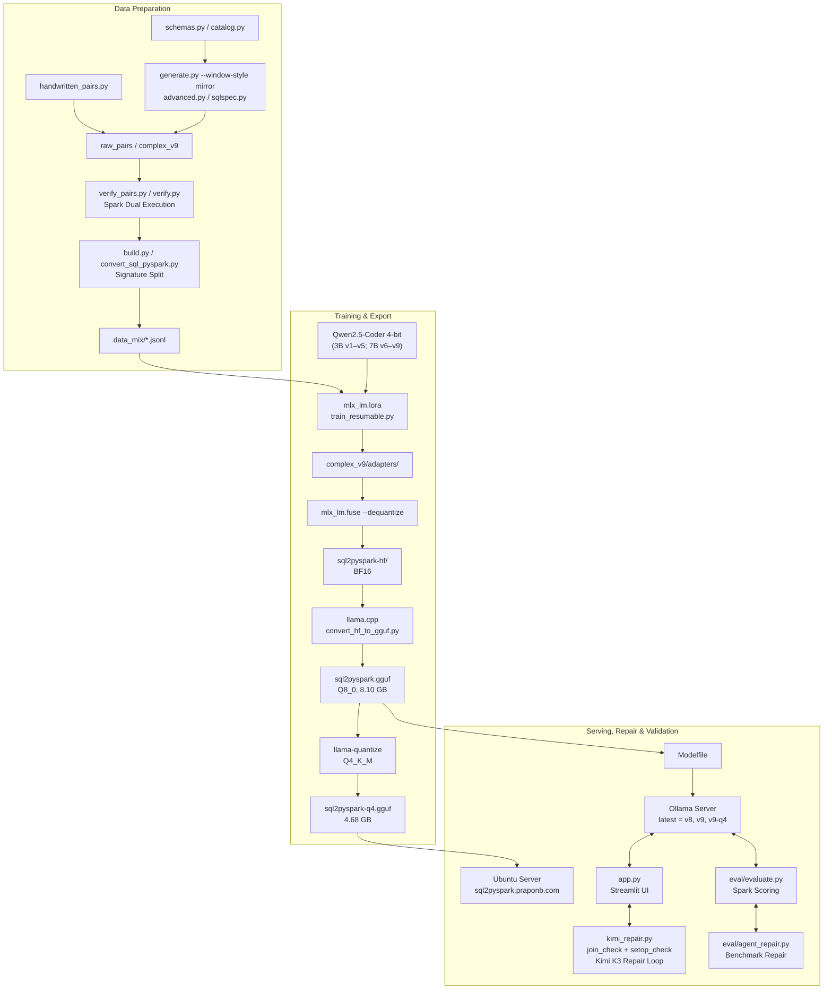

# SQL → PySpark Fine-Tuning Pipeline: Master Project Documentation

**An offline, Apple-Silicon pipeline that LoRA-fine-tunes Qwen2.5-Coder-7B-Instruct (3B up to v5) to translate SQL into idiomatic PySpark DataFrame code.**

This is the single-file version of the guides in [docs/](docs/INDEX.md); each section links to the detailed guide.

---

## 📑 Table of Contents

1. [Executive Summary & Architecture](#1-executive-summary--architecture)
2. [Repository & File Structure](#2-repository--file-structure)
3. [Data Engineering & Synthetic Generation](#3-data-engineering--synthetic-generation)
4. [Spark Dual-Execution Verification](#4-spark-dual-execution-verification)
5. [Leakage-Free Dataset Splitting](#5-leakage-free-dataset-splitting)
6. [LoRA Fine-Tuning & Model Training](#6-lora-fine-tuning--model-training)
7. [Fusion, Dequantization & GGUF Quantization](#7-fusion-dequantization--gguf-quantization)
8. [Ollama Serving & Streamlit Web UI](#8-ollama-serving--streamlit-web-ui)
9. [Execution-Based Evaluation & Benchmarks](#9-execution-based-evaluation--benchmarks)
10. [Operations Runbook & Makefile Reference](#10-operations-runbook--makefile-reference)
11. [Server Deployment](#11-server-deployment)

---

## 1. Executive Summary & Architecture

The goal is a small local model that turns SQL into PySpark code that actually runs and returns the same result. The pipeline:
1. **Generates ~20k SQL/PySpark pairs** with a compositional generator (`sqlspec.py`, `generate_dataset.py`, and since v4 the stage-based `advanced.py` for long pipelines, advanced Spark SQL and nested data) that renders both sides from the same objects, so they agree by construction.
2. **Executes every pair in local Spark** (`verify_pairs.py`) and keeps only pairs whose column names, rows and ORDER BY sequence match: 20,071 of 20,105 pairs pass (v5); 15,499 of 15,500 pass on `complex_v9`.
3. **Splits by feature signature** (`convert_sql_pyspark.py`), so validation and test contain feature combinations that never occur in training.
4. **Fine-tunes Qwen2.5-Coder (4-bit MLX)** with LoRA on a base M2:
   - `v1–v5`: 3B base model (`mlx-community/Qwen2.5-Coder-3B-Instruct-4bit`), validation loss 0.030 → **0.012** (v5, continued from v4, ~5 h 40 min).
   - `v6`: 7B base model (`mlx-community/Qwen2.5-Coder-7B-Instruct-4bit`), fresh adapters, batch 1 × 4 accumulation, validation loss 0.289 → **0.010** (8 h 19 min).
   - `v7`: 7B base model continued from v6 on edge-case mix, validation loss 0.011 → **0.009** (4 h 58 min).
   - `v8`: 7B base model continued from v7 on `complex_v8/data_mix` (17k pairs), validation loss 0.135 → **0.011** (11 h 42 min). Promoted to `sql2pyspark:latest` on 2026-09-30.
   - `v9`: 7B base model continued from v8 on `complex_v9/data_mix` (13,251 pairs) with the **"mirror" window style** (inline `OVER (...)` specs instead of a hoisted block of window variables), validation loss 0.034 → **0.008** (10 h 18 min); exported as Q8_0 (`v9`) and Q4_K_M (`v9-q4`). Candidate, not promoted.
5. **Exports GGUF models**: standard Q8_0 GGUF (8.10 GB) and, since v9, a 4-bit Q4_K_M GGUF (4.68 GB, smaller and faster for the CPU-only server), served by Ollama behind a Streamlit UI (`app.py`).
6. **Execution-based evaluation and repair**:
   - Scores models on 62 unseen hold-out queries (v7 98%, v6 97%, v8 97%, v9 / v9-q4 95%), 25 v4-feature queries (v9-q4 **84%**, v8 72%, v9 72%, v7 64%), 4 real-world production queries, a fixed 150-query test set (v9-q4 140, v8 139, v7 137, v9 134) and 100 complex queries on new tables (v9 / v9-q4 **87**, v8 60, v7 31).
   - `sql2pyspark:latest` = **v8** (7B) in production; candidate **v9-q4** (4-bit v9) fixes most many-window failures (complex test 87 vs. 60) and misses the promotion rule only by one hold-out query.
   - **Kimi K3 repair loop** (`kimi_repair.py`): checks and repairs failed answers on empty tables with declared schemas, fixing 3/4 real-world queries for ~$0.20 per query; includes AST `setop_check()` and `join_check()`.

### Architecture Diagram:


Details: [docs/01-architecture-overview.md](docs/01-architecture-overview.md).

---

## 2. Repository & File Structure

```
Finetuning-LLM/
├── Makefile                      # Pipeline orchestration (`make help`, default TAG=v9 PREV=v8)
├── Modelfile                     # Ollama model definition & system prompt
├── README.md                     # Overview, results table, known gaps
├── PROJECT_DOCUMENTATION.md      # This file
├── app.py                        # Streamlit web converter UI (Ollama + Kimi K3 repair)
├── kimi_repair.py                # Kimi K3 check + repair loop (join_check, setop_check, EmptyTableRunner)
├── requirements.txt              # Pinned dependencies (MLX, PySpark, Streamlit, openai, ...)
├── pyrefly.toml                  # Editor type-checker config (project venv)
├── sql2pyspark.gguf              # 8.10 GB Q8_0 GGUF of the model (v8 in production = `latest`, v9 candidate)
├── sql2pyspark-q4.gguf           # 4.68 GB Q4_K_M GGUF for fast CPU inference on Ubuntu server
├── docker-compose.yml, docker/, .dockerignore   # Docker: app (with Java 17 + PySpark), tools, ollama
├── docs/                         # Detailed guides (INDEX.md + 01–08)
├── deploy/                       # Ubuntu server: sql2pyspark.service (systemd), setup_server.sh, update_model.sh
├── sql2pyspark-mlx/              # Data synthesis, verification & MLX training
│   ├── schemas.py                # 17 base + 5 extra train, 5 base + 1 extra hold-out tables & sample data
│   ├── sqlspec.py                # Dual-rendering expression/query objects
│   ├── generate_dataset.py       # Compositional query generator (12 families + v4/v5 families)
│   ├── advanced.py               # v4/v5 stage-based families (pipelines, advanced SQL, nested data)
│   ├── complex_v8/               # 10k complex pairs dataset build (20 new tables, 8 families), v8 LoRA config + adapters
│   ├── complex_v9/               # 12k complex pairs ("mirror" window style, 20 tables), v9 LoRA config + adapters
│   ├── handwritten_pairs.py      # 105 curated pairs
│   ├── verify_pairs.py           # Parallel PySpark verification
│   ├── convert_sql_pyspark.py    # Signature splitter & chat formatter
│   ├── lora_config.yaml          # MLX LoRA hyperparameters (v7/v8/v9: 7B)
│   ├── train_resumable.py        # Crash-proof training wrapper (`make train`)
│   ├── train.log                 # Last training log (v7; older ones in runs/vN/)
│   ├── data/                     # train.jsonl (16.9k), valid.jsonl, test.jsonl, *_meta.jsonl
│   ├── raw_pairs/                # Generated pairs, verified.jsonl & reports
│   ├── adapters/                 # LoRA weights (v9 in complex_v9/, v8 in complex_v8/, v7 in adapters/)
│   ├── runs/v2/ … runs/v8/       # Backups: adapters, logs, configs (v2–v5 data only in git history)
│   └── sql2pyspark-model/        # Fused 4-bit MLX model (only between `make fuse` and `make clean`)
├── sql2pyspark-hf/               # Dequantized BF16 fused model (~15.2 GB, only between `make fuse` and `make clean`)
├── eval/                         # Execution-based evaluation
│   ├── build_holdout.py          # 62 hand-written queries on unseen tables
│   ├── holdout.jsonl             # Hold-out benchmark
│   ├── build_holdout_v4.py       # 25 hand-written queries for the v4 features
│   ├── holdout_v4.jsonl          # v4 feature benchmark
│   ├── build_real_queries.py     # 4 real-world production queries checked in Spark
│   ├── real_queries.jsonl        # Real-world query benchmark (real001–real004)
│   ├── real_tables.py            # Sample tables for real-world queries
│   ├── evaluate.py               # Strict/lenient execution evaluator (--tables, --num-predict, --option)
│   ├── agent_repair.py           # Kimi K3 repair loop for failed answers (key in .env)
│   ├── report.py                 # Markdown results-table generator
│   ├── post_training_v4.sh       # v4 export + evaluation chain
│   ├── post_training_v5.sh       # v5 export + evaluation chain
│   ├── post_training_v6.sh       # v6 export + evaluation chain (--timeout 600)
│   ├── start_training_v7.sh      # v7 unattended training launcher
│   ├── post_training_v7.sh       # v7 post-training export + eval chain
│   ├── start_training_v8.sh, post_training_v8.sh, complex_eval_v8.sh   # v8 train / export+eval / complex test chain
│   ├── start_training_v9.sh      # v9 automated end-to-end launcher (train, Q8/Q4 export, evals)
│   ├── complex_v8_test.jsonl     # 300 held-out complex_v8 test pairs
│   ├── logs-repair-rules/        # Console logs for v7 repair with Spark-default rules
│   └── results/                  # <tag>__<set>.json results (+ v2..v4-split, v5..v8-repair, v7-repair-rules, v9 results)
└── llama.cpp/                    # Upstream checkout used for convert_hf_to_gguf.py
```

The code is in the private GitHub repo `praponb/Finetuning-LLM`. `.gitignore` keeps model weights, generated data, venvs, `llama.cpp/`, `archive/` and `sql2pyspark-mlx/runs/` out of git; `archive/` (earlier experiments and the v1 model) and the legacy `mlx-env/` venv were deleted on 2026-09-27, and `sql2pyspark-hf/` can be deleted too (recreated by `make fuse`).

Details: [docs/06-file-catalog-and-reference.md](docs/06-file-catalog-and-reference.md).

---

## 3. Data Engineering & Synthetic Generation

### A. Schema Catalog (`schemas.py`)
- **17 base training tables**: `customers`, `orders`, `order_items`, `products`, `suppliers`, `employees`, `departments`, `accounts`, `transactions`, `sessions`, `web_events`, `payments`, `shipments`, `stores`, `inventory`, `store_sales`, `subscriptions`.
- **5 extra nested training tables**: `carts` (arrays of structs, maps, coupon arrays), `app_logs` (payload JSON, latency, context map), `price_tiers` (array limits/prices/discounts), `device_readings` (telemetry, status bits, firmware), `promotions` (promo dates and discounts).
- **5 base hold-out tables** (`holdout=True`): `patients`, `doctors`, `appointments`, `flights`, `bookings`. Never used for training data; they test generalisation to unseen schemas.
- **1 extra nested hold-out table**: `vehicle_trips` (stops struct arrays, route struct, telemetry JSON, fare components).
- **Sample data**: `make_dataframes(spark, seed=7)` builds deterministic DataFrames for all 28 tables with typed columns (ids, foreign keys, numbers, categories, strings, dates, timestamps, booleans, arrays, structs, maps, JSON), including NULLs and custom generator closures (`Table.rows`).

### B. Dual-Rendering Engine (`sqlspec.py`)
Queries are trees of objects: expressions (`Col`, `Lit`, `BinOp`, `Fn`, `Case`, `Cast`, `Agg`, `WinFn`), predicates (`Cmp`, `InList`, `Between`, `Like`, `IsNull`, `And`, `Or`, `Not`) and query objects (`WinSpec`, `Rel`, `Join`, `Semi`, `Sel`). Every expression implements:
- `.sql(style)`: Spark SQL with randomized surface style (keyword case, layout, aliases, `<>` vs `!=`, ...).
- `.py(ctx)`: the equivalent PySpark following the output conventions.

### C. 12 Query Families (`generate_dataset.py`)
1. `fam_select`: projections, boolean filter trees (`AND`, `OR`, `NOT`, `BETWEEN`, `IN`, `LIKE`, `IS NULL`), computed columns, `DISTINCT`, `ORDER BY` / `LIMIT`.
2. `fam_agg`: `GROUP BY` (columns or expressions), aggregates incl. conditional ones, `HAVING`, `ROLLUP` / `CUBE`.
3. `fam_join`: `INNER`, `LEFT`, `RIGHT`, `FULL OUTER` joins, join chains, self-joins, composite keys.
4. `fam_join_agg`: joins followed by grouping and aggregation.
5. `fam_window`: `ROW_NUMBER`, `RANK`, `DENSE_RANK`, `NTILE`, `PERCENT_RANK`, `LAG` / `LEAD`, partition totals, running and moving aggregates, `FIRST_VALUE` / `LAST_VALUE`.
6. `fam_topn`: top-N per group through a ranked CTE or derived table.
7. `fam_cte_agg_join`: aggregated CTE (or derived table) joined back to a parent table.
8. `fam_cte_chain`: two-step CTE pipelines.
9. `fam_derived`: aggregated subquery in `FROM`, filtered by the outer query.
10. `fam_subquery`: `IN`, `EXISTS`, `NOT EXISTS`, `NOT IN`, scalar and correlated subqueries (semi/anti joins, precomputed values, window aggregates).
11. `fam_setop`: `UNION ALL`, `UNION`, `EXCEPT`, `INTERSECT`.
12. `fam_special`: `PIVOT`, `EXPLODE` / `LATERAL VIEW`, `CROSS JOIN`, window functions over aggregates.

**v4 stage-based families (`advanced.py`)**: a query is a chain of stages, each one a CTE, rendered to SQL and PySpark together: cleaning with `TIMESTAMP` literals, `ROW_NUMBER`/`RANK` dedup via `QUALIFY` or subquery, 2–5 different windows (`LAG/LEAD`, `ROWS n PRECEDING` and epoch `RANGE` frames, `NULLS FIRST/LAST`, `CUME_DIST`, `NTILE`, `LAST_VALUE ... IGNORE NULLS`, named `WINDOW`), `INTERVAL` gaps-and-islands sessions, foreign-key / validity-window / `<=>` / `COALESCE`-key joins, `LATERAL ... LIMIT 1`, `[NOT] EXISTS` with extra correlated conditions, `EXCEPT/INTERSECT [ALL]`, aggregation with `GROUPING SETS` / `ROLLUP` / `CUBE` / `GROUPING_ID` / `FILTER (WHERE ...)` / `COUNT_IF` / `NULLIF` / `PERCENTILE_APPROX` / `CORR` / `BIT_OR`, multi-aggregate `PIVOT`, `UNPIVOT`, final reports with correlated scalar subqueries and `RLIKE`, and nested data (`LATERAL VIEW [OUTER] EXPLODE/POSEXPLODE`, `INLINE`, struct fields, map lookups, `TRY_CAST`, `FROM_JSON`, `GET_JSON_OBJECT`, `TRANSFORM/FILTER/EXISTS/FORALL/AGGREGATE/ZIP_WITH`, bit masks). `fam_adv_*` families are 1–2-stage feature queries; `fam_pipeline` chains 4–8 stages into production-style queries (up to ~3.1k tokens). Row-order-dependent windows always use a unique tie-breaker, so both sides return the same rows. `UNION` (with `.distinct()`) is drawn more often than `UNION ALL` since v4.

**v5 generator changes**: exact final projections instead of `SELECT *` (6 of v4's 16 v4-hold-out misses were wrong column lists), `<=>` / `IS [NOT] DISTINCT FROM`, a new `stg_join_agg` stage (join + `GROUPING SETS` / `ROLLUP` / `CUBE` + `GROUPING_ID` in one SELECT), `unpivot(...)` with keyword arguments, aliased `LATERAL VIEW` explodes and `pos + 1`, more `LATERAL` / `EXISTS` / scalar subqueries, denser 5–8-stage pipelines with window reuse, more renamed-column `UNION`s and `SELECT DISTINCT` cross joins, and fixes for empty-result `HAVING` / `NOT IN` filters. v5 data: seed 5, 20,073 of 20,105 verified, train mix 55% classic / 25% short v4 features / 20% pipelines, with the fixed test set excluded.

**complex_v8 dataset**: 20 new tables across 6 domains (`ecommerce`, `finance`, `iot`, `telecom`, `healthcare`, `logistics`) in `catalog.py`. 8 multi-stage query families (`cx_pipeline`, `cx_window_heavy`, `cx_setops`, `cx_grouping`, `cx_reshape`, `cx_sessions`, `cx_range_join`, `cx_full_outer`). 12,999/13,000 pairs verified in Spark. Split into 10,000 train, 500 valid, and 300 test pairs, mixed with 7,000 v7 pairs to form `data_mix` (17,000 train).

**complex_v9 dataset & "Mirror" Window Style**: Targets v8's many-window failures (1/15 on `cx_window_heavy`: hoisting every window spec as a variable made the model repeat definitions until the token limit). Under the "mirror" style (`generate.py --window-style mirror`), inline SQL `OVER (...)` specs are translated directly inline (`.over(Window.partitionBy(...).orderBy(...))`), while variable definitions are reserved strictly for queries with explicit SQL `WINDOW w AS (...)` clauses. 15,499 of 15,500 pairs verified in Spark. Comprises 11,989 train + 1,990 extra window-heavy pairs, mixed with v7 replays into 13,251 training examples.

**v3 generator changes** (targeting the v2 hold-out failures):
- Set operations over *differently named* columns (positional, aliased on the right, or aliased on both sides): `.union()` when the names differ, `.unionByName()` when they match.
- `GROUP BY` keys referenced by expression, alias or ordinal, with ordinals more common on `CASE` keys.
- Exact `NOT IN` semantics: `.filter(F.col(x).isNotNull() | F.lit(excluded.isEmpty()))` after the anti join.

### D. 105 Curated Pairs (`handwritten_pairs.py`)
The v1 hand-written set, ported to the v2 schema and conventions. It covers things the generator rarely produces: `%`, `POWER`, `NULLS LAST`, `SPLIT`, `REGEXP_EXTRACT`, `DATEDIFF`, `ADD_MONTHS`, `CROSS JOIN`, cross-table `INTERSECT` / `EXCEPT`, `ROLLUP`, `CUBE`, `PIVOT`. All are execution-verified and always go to training.

Details: [docs/02-data-engineering-pipeline.md](docs/02-data-engineering-pipeline.md).

---

## 4. Spark Dual-Execution Verification

[verify_pairs.py](sql2pyspark-mlx/verify_pairs.py) executes both sides of every pair in local Spark:
$$\text{spark.sql}(SQL) \stackrel{?}{=} \text{exec}(PySpark)$$

### Verification Criteria:
1. **Columns**: names and order must match exactly.
2. **Rows**: normalized rows (numbers rounded to 4 decimals, ISO dates/timestamps, NaN standardized) must match as a multiset (`Counter`).
3. **Order**: if the query has `ORDER BY`, the sequence of the ORDER BY columns must match.

### Verification Run Results (`raw_pairs/verify_report.json`, v4):
- **Checked**: 20,105 pairs
- **Passing**: **20,068 (99.8%)**; 36 SQL errors (mostly `CORR` dividing by zero under ANSI mode) and 1 row mismatch are dropped; 2,254 passing pairs return an empty result, which makes their check weaker
- **Time**: 1,185.7 s (~20 min) with 4 worker processes, built natively (log in `sql2pyspark-mlx/data_v4.log`)
- v3: all 15,105 pairs passed in 561.6 s (built in the Docker `tools` container, `runs/v3/data_v3_docker.log`).
- v2 had one failure (15,104 of 15,105): a `NOT IN` subquery that returns no rows keeps NULL keys in SQL, but the generated PySpark filtered them out. v3 fixes the generator.

---

## 5. Leakage-Free Dataset Splitting

[convert_sql_pyspark.py](sql2pyspark-mlx/convert_sql_pyspark.py) groups verified pairs by **feature signature**:
$$\text{Signature} = \text{family} \;\|\; \text{sorted}(\text{feature\_tags})$$

Whole signatures are held out for validation (10%) and test (5%). A signature is only held out if it's small (≤2% of pairs) and every one of its features keeps at least 30 training examples. The 105 hand-written pairs always go to training.

### Split Statistics (`data/split_stats.json`, v4):
- **Pairs**: 20,068
- **Training (`train.jsonl`)**: 16,924 pairs (8,693 signatures; 7,145 from the v4 families, 2,662 of them pipelines)
- **Validation (`valid.jsonl`)**: 2,096 pairs (1,037 signatures)
- **Test (`test.jsonl`)**: 1,048 pairs (513 signatures)
- **Signatures shared with training**: **0**
- **Features missing from training**: **0**

---

## 6. LoRA Fine-Tuning & Model Training

- **Base models**:
  - `v1–v5`: `mlx-community/Qwen2.5-Coder-3B-Instruct-4bit` (36 layers, 3.09 B parameters)
  - `v6`: `mlx-community/Qwen2.5-Coder-7B-Instruct-4bit` (28 layers, 7.61 B parameters)
- **Framework**: Apple MLX (`mlx-lm`)
- **Config**: [lora_config.yaml](sql2pyspark-mlx/lora_config.yaml)

### v9 (7B Model, Continued from v8 on complex_v9)
- **Data**: `sql2pyspark-mlx/complex_v9/` with the "mirror" window style. 15,499/15,500 pairs verified in Spark; 11,989 train + 1,990 window-heavy pairs, blended into a 13,251 training mix with v7 replays.
- **Training**: `complex_v9/lora_config.yaml`, resumed from v8 adapters (`./complex_v8/adapters/adapters.safetensors`), 2,400 micro-batches (600 updates of batch 1 × 4 accumulation), peak LR 5e-5 with cosine decay to 5e-6, 10 h 18 min on a base M2 (2026-09-30 19:05 → 10-01 05:23), peak memory 10.0 GB; validation loss 0.034 → 0.018 → 0.007 → **0.008**; adapters in `complex_v9/adapters/`.
- **Export & Quantization**: exported to standard Q8_0 GGUF (`sql2pyspark.gguf`, 8.10 GB) and Q4_K_M GGUF (`sql2pyspark-q4.gguf`, 4.68 GB), both from one f16 export with `llama-quantize`.
- **Automation**: `eval/start_training_v9.sh` (end-to-end runner: verifies data, trains, fuses, exports Q8 and Q4 GGUFs, registers Ollama tags `sql2pyspark:v9` and `:v9-q4`, benchmarks across all test suites).

### v8 (7B Model, Continued from v7 on complex_v8)
- **Data**: `sql2pyspark-mlx/complex_v8/` is a standalone build (no change to the v1–v7 generator): 20 new tables in 6 domains, 8 multi-stage families (pipelines, 8–16-window queries, set operations incl. positional `UNION`s, grouping sets, PIVOT/UNPIVOT, sessions, range joins, FULL OUTER JOINs); 12,999 of 13,000 pairs match in Spark; 10,000 train / 500 valid / 300 test; `data_mix/` adds 7,000 v7 pairs.
- **Training**: `complex_v8/lora_config.yaml`, resume from v7 (`./adapters`), 3,200 micro-batches (800 updates), peak LR 5e-5, 11 h 42 min, peak 10.0 GB, validation loss 0.135 → **0.011**; adapters in `complex_v8/adapters/`.
- **Automation**: `eval/start_training_v8.sh`, `eval/post_training_v8.sh`, `eval/complex_eval_v8.sh`.

### v7 (7B Model, Continued from v6)
To address the remaining hold-out edge cases (`holdout015` date division slips, `holdout031` unrelated column set operations, and window partition expressions), v7 continues fine-tuning Qwen2.5-Coder-7B from v6's adapters:
- **Adapter source**: `resume_adapter_file: ./runs/v6/adapters/adapters.safetensors`
- **Optimizer updates**: 600 updates of 4 samples (2,400 micro-batches of `batch_size: 1` with `grad_accumulation_steps: 4`).
- **Learning rate**: halved peak LR at $5.0 \times 10^{-5}$ (50 warmup updates, cosine decay to $5.0 \times 10^{-6}$ over 550 updates).
- **Dataset**: v7 mix with DATEDIFF arithmetic (`fn_date_arith`), expressions in window partitions (`window_expr_partition`), and unrelated column set operations with NOT NULL filters (`set_unrelated`, `set_not_null_filter`).
- **Duration**: 4 h 58 min on a base M2 (18:13 → 23:11), peak 9.9 GB; validation loss 0.011 → 0.021 (step 800) → 0.010 → **0.009**.
- **Automation**: `eval/start_training_v7.sh` (unattended runner) and `eval/post_training_v7.sh` (export, 4 benchmarks with `--timeout 600`, Docker reload, Kimi repair).

### v6 (7B Model, Fresh Adapters)
To address long-query repetition loops and increase capacity for multi-CTE pipelines, v6 scales to the 7B coder base model on the v5 replay-heavy mix (55% classic, 25% short v4 features, 20% pipelines):
- **Optimizer updates**: 1,200 updates of 4 samples, run as 4,800 micro-batches of `batch_size: 1` with `grad_accumulation_steps: 4`.
- **Memory tuning**: dry run on the longest samples showed `batch_size: 2` with checkpointing caused Metal OOM on a 16 GB Mac; `batch_size: 1` with gradient accumulation 4 and gradient checkpointing peaks at **9.0–9.2 GB** (full run: 10.11 GB), fitting unified memory at ~40–50 trained tokens/s (**8 h 19 min** total).
- **Adapted layers**: last 8 of 28 transformer blocks.
- **Learning rate**: fresh schedule starting with 100 warmup updates to $1.0 \times 10^{-4}$, decaying to $1.0 \times 10^{-5}$ over 1,100 updates.
- **Automation**: `eval/post_training_v6.sh` monitors `train.log`, exports `sql2pyspark:v6`, evaluates across all 4 benchmark sets (`--timeout 600`), and reloads the Docker app container.

### v5 (Continued from v4, 3B Model)
`resume_adapter_file: ./runs/v4/adapters/adapters.safetensors`, peak learning rate 5e-5 (50 warmup updates, cosine to 5e-6); 1,200 updates on the v5 mix, 17:17 → 22:56 (5 h 39 min), peak 10.31 GB. Validation loss 0.030 → 0.020 → 0.017 → 0.014 → **0.012** at iterations 1 / 600 / 1,200 / 1,800 / 2,400.

### Key Parameters (v4/v5, 3B Model):
- **Adapted layers**: last 8 transformer blocks (of 36)
- **LoRA rank**: 16 | **scale**: 20.0 | **dropout**: 0.05 (6.65 M trainable parameters)
- **Updates**: 1,200 optimizer updates of 4 samples, run as 2,400 micro-batches of 2 with gradient accumulation 2 (~0.28 epoch over 16.9k samples)
- **Sequence length**: `max_seq_length: 3200` (longest v4 sample 3,119 tokens; v3 data: 603)
- **Gradient checkpointing**: enabled
- **Peak memory**: 9.74 GB (v4), 10.31 GB (v5)
- **Duration**: ~5 h 16 min (v4), ~5 h 39 min (v5) on a base Apple M2 (16 GB)
- **Crash-proof**: `make train` runs [train_resumable.py](sql2pyspark-mlx/train_resumable.py): smaller Metal command buffers (`MLX_MAX_OPS_PER_BUFFER=2`, `MLX_MAX_MB_PER_BUFFER=40`) and automatic resume from the newest checkpoint.

Note: don't run Ollama or Docker while training on a 16 GB Mac; Ollama plus training caused a Metal out-of-memory crash, and Docker Desktop's VM takes another 8 GB.

Details: [docs/03-model-training-and-export.md](docs/03-model-training-and-export.md).

---

## 7. Fusion, Dequantization & GGUF Quantization

To package the fine-tuned model for Ollama (`make export TAG=v9`):

1. **4-bit MLX fusion**:
   `mlx_lm.fuse --model ... --adapter-path complex_v9/adapters --save-path sql2pyspark-model`
2. **BF16 dequantization**:
   `mlx_lm.fuse --model ... --adapter-path complex_v9/adapters --save-path ../sql2pyspark-hf --dequantize`
   (~15.2 GB BF16 safetensors for 7B, ~6.2 GB for 3B).
3. **Q8_0 & Q4_K_M GGUF conversion**:
   - Standard Q8_0:
     `python llama.cpp/convert_hf_to_gguf.py sql2pyspark-hf --outtype q8_0 --outfile sql2pyspark.gguf`
     (**8.10 GB** for 7B; whole export ~2.5 min).
   - Fast 4-bit CPU quantization:
     `./llama.cpp/build/bin/llama-quantize sql2pyspark.gguf sql2pyspark-q4.gguf Q4_K_M`
     (**4.68 GB** for 7B, cuts CPU RAM by ~40% and doubles generation speed).
4. **Ollama registration and promotion**:
   `ollama create sql2pyspark:v9 -f Modelfile`. `sql2pyspark:latest` currently points to **v8** (`make promote TAG=v8 PREV=v7`, promoted on 2026-09-30). `sql2pyspark:v9` and `:v9-q4` are available as candidate tags. Roll back anytime with `ollama cp sql2pyspark:<PREV> sql2pyspark:latest`.

---

## 8. Ollama Serving & Streamlit Web UI

### Ollama Serving:
- Serves completions at `http://localhost:11434/api/chat`; `app.py` and `eval/evaluate.py` read `OLLAMA_URL` to use another server.
- Chat template, stop token, sampling parameters and system prompt are in the [Modelfile](Modelfile).

### Streamlit Web Application (`app.py`):
- **Two columns**: SQL input on the left, generated PySpark on the right (with a copy button).
- **Model tag field in the sidebar**: any Ollama tag, e.g. `sql2pyspark:latest` (v8 in production), `sql2pyspark:v9`, `sql2pyspark:v9-q4`, or `sql2pyspark:v7` (v1–v6 were removed on 2026-09-30).
- **Robust code extraction**: `extract_code()` also handles replies that stop before the closing code fence.
- **Error handling**: clear messages when Ollama is unreachable or the input is blank; 180 s timeout (600 s for SQL longer than 2,000 characters; 120/300 s before the 7B model).
- **Long SQL** (> 2,000 characters): `repeat_last_n=2048` stops the window-definition loops seen on long real queries; v9's "mirror" window style removes this on complex-style queries, but `real001` still loops on v9.

### Kimi K3 Verification & Repair Loop (`kimi_repair.py`):
With `KIMI_API_KEY` set (in `.env` or passed into Docker), `app.py` provides automated post-processing:
1. **Static AST & set-operation/join check** (`static_check(code, sql)`): instant check for syntax errors, undefined names (such as `w93` from repetition loops), a missing `result` variable, `.unionByName()` used for positional `UNION`/`INTERSECT`/`EXCEPT` with differently named columns (`setop_check()`), and unqualified `F.col("<name>")` in join conditions between aliased DataFrames (`join_check()`).
2. **Empty table execution** (`EmptyTableRunner`): Kimi K3 (Moonshot AI, `reasoning_effort=high`) infers table schemas from the SQL, runs the code on empty PySpark tables in a local `SparkSession`, and verifies that output columns match the SQL's columns.
3. **Sidebar controls**: options to repair *When a check fails or the SQL is long* (default; long = over 2,000 characters), *When a check fails*, *Always*, or *Off*, plus a manual *Check and repair with Kimi K3* button. Long SQL queries are repaired by default because model mistakes on long multi-stage queries often only manifest when the code runs.
4. **Container readiness**: `docker/app.Dockerfile` includes Java 17 and PySpark (2.1 GB image), running the local Spark checks seamlessly inside the container.
- **Run**: `make app` → `http://localhost:8501`, or `docker compose up -d --build` for the containerized UI.

Details: [docs/05-serving-and-streamlit-ui.md](docs/05-serving-and-streamlit-ui.md).

---

## 9. Execution-Based Evaluation & Benchmarks

The suite in `eval/` scores models by executing their answers in Spark and comparing them with the SQL result.

### Benchmark Sets:
1. **Hold-out set (`eval/holdout.jsonl`)**: 62 hand-written queries (15 simple, 22 medium, 25 complex) on unseen tables (`patients`, `doctors`, `appointments`, `flights`, `bookings`).
2. **v4 hold-out set (`eval/holdout_v4.jsonl`)**: 25 hand-written queries for the v4 features (aggregation, window, join, set operation, reshape, nested, pipeline groups) on the hold-out tables plus the nested `vehicle_trips`.
3. **Real-world queries (`eval/real_queries.jsonl`)**: 4 complex production SQL queries supplied by users, evaluated on hand-made sample tables in `eval/real_tables.py` (`--tables eval/real_tables.py`); `real003`/`real004` use a `ref_sql` rewrite for the expected result where Spark rejects the original syntax:
   - `real001`: Marketing attribution (4 CTEs, non-equi interval join, dedup windowing, grouping sets)
   - `real002`: Order fulfillment & routing (higher-order array lambdas, lateral view explode, RANGE windows, QUALIFY, PIVOT)
   - `real003`: IoT telemetry & calibration (complex JSON parsing, bitwise masks, UNPIVOT, correlated LATERAL join, stateful imputation)
   - `real004`: Trade analytics & settlement (regex tokens, try_cast, higher-order array ZIP_WITH / fold, sessionization gaps-and-islands, CUBE with grouping_id)
4. **Fixed test set (`eval/test_fixed.jsonl`, since v5)**: 150 generated queries of the v4 test split (97 classic, 53 v4-family incl. 22 pipelines), removed from later training data; v3, v4 and v5 are all scored on exactly these queries. Older samples: `eval/results/v3-split/` (v2 95%, v3 95%, 300 queries) and `v2-split/`.

**Strict** scoring runs the code as returned (it must assign `result`); **lenient** scoring adds imports, binds a bare `df`, and takes the last expression as the result, to be fair to v1. Replies are capped at 2,048 tokens.

### Results:
| Model | Eval set | n | Syntax OK | Runs (strict) | Correct (strict) | Runs (lenient) | Correct (lenient) | s / query |
|---|---|---|---|---|---|---|---|---|
| `sql2pyspark:v1` | holdout | 62 | 79% | 0% | **0%** | 16% | **6%** | 4.2 |
| `sql2pyspark:v2` | holdout | 62 | 98% | 92% | **90%** | 92% | **90%** | 4.1 |
| `sql2pyspark:v3` | holdout | 62 | 97% | 95% | **95%** | 95% | **95%** | 3.3 |
| `sql2pyspark:v4` | holdout | 62 | 100% | 95% | **94%** | 95% | **94%** | 4.0 |
| `sql2pyspark:v5` | holdout | 62 | 97% | 92% | **90%** | 92% | **90%** | 4.3 |
| `sql2pyspark:v6` | holdout | 62 | 100% | 97% | **97%** | 97% | **97%** | 9.9 |
| `sql2pyspark:v7` | holdout | 62 | 100% | 98% | **98%** | 98% | **98%** | 9.1 |
| `sql2pyspark:v8` | holdout | 62 | 100% | 97% | **97%** | 97% | **97%** | 9.3 |
| `sql2pyspark:v9` | holdout | 62 | 100% | 95% | **95%** | 95% | **95%** | 7.3 |
| `sql2pyspark:v9-q4` | holdout | 62 | 100% | 95% | **95%** | 95% | **95%** | 8.3 |
| `sql2pyspark:v2` | holdout_v4 | 25 | 92% | 32% | **20%** | 32% | **20%** | 6.5 |
| `sql2pyspark:v3` | holdout_v4 | 25 | 88% | 32% | **12%** | 32% | **12%** | 7.1 |
| `sql2pyspark:v4` | holdout_v4 | 25 | 96% | 60% | **36%** | 60% | **36%** | 7.0 |
| `sql2pyspark:v5` | holdout_v4 | 25 | 88% | 68% | **56%** | 68% | **56%** | 8.1 |
| `sql2pyspark:v6` | holdout_v4 | 25 | 100% | 80% | **64%** | 80% | **64%** | 18.4 |
| `sql2pyspark:v7` | holdout_v4 | 25 | 100% | 80% | **64%** | 80% | **64%** | 16.4 |
| `sql2pyspark:v8` | holdout_v4 | 25 | 100% | 76% | **72%** | 76% | **72%** | 17.1 |
| `sql2pyspark:v9` | holdout_v4 | 25 | 100% | 76% | **72%** | 76% | **72%** | 13.3 |
| `sql2pyspark:v9-q4` | holdout_v4 | 25 | 100% | 84% | **84%** | 84% | **84%** | 16.2 |
| `sql2pyspark:v2` | real_queries | 4 | 0% | 0% | **0%** | 0% | **0%** | 55.3 |
| `sql2pyspark:v3` | real_queries | 4 | 0% | 0% | **0%** | 0% | **0%** | 78.9 |
| `sql2pyspark:v4` | real_queries | 4 | 25% | 0% | **0%** | 0% | **0%** | 92.8 |
| `sql2pyspark:v5` | real_queries | 4 | 50% | 0% | **0%** | 0% | **0%** | 75.6 |
| `sql2pyspark:v6` | real_queries | 4 | 75% | 0% | **0%** | 0% | **0%** | 189.4 |
| `sql2pyspark:v7` | real_queries | 4 | 50% | 0% | **0%** | 0% | **0%** | 163.6 |
| `sql2pyspark:v8` | real_queries | 4 | 100% | 0% | **0%** | 0% | **0%** | 195.5 |
| `sql2pyspark:v9` | real_queries | 4 | 75% | 0% | **0%** | 0% | **0%** | 131.2 |
| `sql2pyspark:v9-q4` | real_queries | 4 | 75% | 0% | **0%** | 0% | **0%** | 164.5 |
| `sql2pyspark:v3` | test_fixed | 150 | 92% | 73% | **69%** | 73% | **70%** | 8.0 |
| `sql2pyspark:v4` | test_fixed | 150 | 90% | 80% | **73%** | 80% | **73%** | 11.6 |
| `sql2pyspark:v5` | test_fixed | 150 | 97% | 88% | **85%** | 89% | **85%** | 11.2 |
| `sql2pyspark:v6` | test_fixed | 150 | 99% | 91% | **88%** | 91% | **88%** | 22.5 |
| `sql2pyspark:v7` | test_fixed | 150 | 100% | 93% | **91%** | 93% | **91%** | 25.8 |
| `sql2pyspark:v8` | test_fixed | 150 | 99% | 96% | **93%** | 96% | **93%** | 24.3 |
| `sql2pyspark:v9` | test_fixed | 150 | 99% | 94% | **89%** | 94% | **89%** | 19.4 |
| `sql2pyspark:v9-q4` | test_fixed | 150 | 100% | 97% | **93%** | 97% | **93%** | 18.6 |
| `sql2pyspark:v7` | complex_v8_test | 100 | 83% | 38% | **31%** | 38% | **31%** | 72.9 |
| `sql2pyspark:v8` | complex_v8_test | 100 | 96% | 68% | **60%** | 68% | **60%** | 96.9 |
| `sql2pyspark:v9` | complex_v8_test | 100 | 100% | 92% | **87%** | 92% | **87%** | 57.9 |
| `sql2pyspark:v9-q4` | complex_v8_test | 100 | 99% | 91% | **87%** | 91% | **87%** | 39.2 |

Hold-out, correct results (lenient) by difficulty:

| Model | simple (n=15) | medium (n=22) | complex (n=25) |
|---|---|---|---|
| `sql2pyspark:v1` | 7% | 14% | 0% |
| `sql2pyspark:v2` | 93% | 95% | 84% |
| `sql2pyspark:v3` | 100% | 95% | 92% |
| `sql2pyspark:v4` | 100% | 95% | 88% |
| `sql2pyspark:v5` | 93% | 95% | 84% |
| `sql2pyspark:v6` | 93% | 95% | 100% |
| `sql2pyspark:v7` | 100% | 95% | 100% |
| `sql2pyspark:v8` | 100% | 91% | 100% |
| `sql2pyspark:v9` | 100% | 91% | 96% |
| `sql2pyspark:v9-q4` | 100% | 91% | 96% |

v4 hold-out, correct results (lenient) by feature group:

| Model | aggregation (n=4) | window (n=5) | join (n=5) | setop (n=3) | reshape (n=2) | nested (n=4) | pipeline (n=2) |
|---|---|---|---|---|---|---|---|
| `sql2pyspark:v2` | 0% | 40% | 20% | 67% | 0% | 0% | 0% |
| `sql2pyspark:v3` | 0% | 40% | 0% | 33% | 0% | 0% | 0% |
| `sql2pyspark:v4` | 25% | 40% | 20% | 67% | 50% | 50% | 0% |
| `sql2pyspark:v5` | 50% | 100% | 40% | 67% | 50% | 50% | 0% |
| `sql2pyspark:v6` | 75% | 80% | 60% | 67% | 50% | 50% | 50% |
| `sql2pyspark:v7` | 50% | 80% | 60% | 33% | 100% | 75% | 50% |
| `sql2pyspark:v8` | 100% | 60% | 60% | 67% | 100% | 75% | 50% |
| `sql2pyspark:v9` | 75% | 100% | 100% | 33% | 50% | 50% | 50% |
| `sql2pyspark:v9-q4` | 75% | 100% | 100% | 67% | 50% | 75% | 100% |

### v9 results (2026-10-01, candidate)
| Eval set | v8 | v9 (Q8_0) | v9-q4 (Q4_K_M) | Rule (vs. v8) |
|---|---|---|---|---|
| Hold-out (62) | 60 | 59 | **59** | ❌ ≥ 60 (both) |
| Fixed test: classic (97) | 97 | 96 | **97** | v9 ❌, v9-q4 ✅ |
| Fixed test: all (150) | 139 | 134 | **140** | v9 ❌, v9-q4 ✅ ≥ 139 |
| v4 hold-out (25) | 18 | 18 | **21** | v9 tie, v9-q4 ✅ |
| Real-world (4) | 0 | 0 | 0 | ❌ ≥ 1 |
| complex_v8 test (100) | 60 | 87 | **87** | ✅ (many-window 1 → 11 / 12 of 15) |

v9 trains on the complex_v8 queries re-rendered in the **"mirror" window style** (`generate.py --window-style mirror`: inline `Window` spec for `OVER (...)`, a variable only for a SQL-named `WINDOW`), which fixed v8's many-window failures (hoisted definition blocks that looped until the token limit):
- **complex_v8 test 87/100** (v8 60): many-window queries 11/15 (v9-q4 12/15; v8 1/15), pipelines 26–27/32 (15), and ~40% faster per query.
- **Hold-out 59/62**: new miss `holdout052` (unqualified `F.col("id")` in a `NOT IN` → `left_anti` join), which the new `join_check()` flags in the app. **Real queries** still 0/4: `real001` still loops; the classic-table training targets still hoist windows.
- **Q4_K_M**: `sql2pyspark:v9-q4` (4.68 GB) is equal or better than the Q8_0 build on every set (differences within noise) and faster on the Mac; CPU speed on the server not measured yet. It misses only the hold-out rule (by one query) and is the recommended promotion candidate (`make promote TAG=v9-q4 PREV=v8`, owner's decision).

### v8 decision (2026-09-30, promoted)
| Eval set | v6 | v7 | v8 | Rule (vs. v7) |
|---|---|---|---|---|
| Hold-out (62) | 60 | 61 | **60** | ❌ ≥ 61 |
| Fixed test: classic (97) | 96 | 97 | **97** | ✅ ≥ 94 |
| Fixed test: all (150) | 132 | 137 | **139** | ✅ ≥ 137 |
| v4 hold-out (25) | 16 | 16 | **18** | ✅ > 16 |
| Real-world (4) | 0 | 0 | 0 | ❌ ≥ 1 |
| complex_v8 test (100) | — | 31 | **60** | — |

v8 continues from v7 on `complex_v8/data_mix` (10,000 new complex pairs + 7,000 v7 pairs; 3,200 steps, 11 h 42 min). It gains on the v4 hold-out, the fixed test set and, strongly, the new complex test (set operations 21/25 vs. 4/25; many-window queries still 1/15), and the Kimi repair fixes its real-world answers 4/4 in both modes. It loses `holdout024` (unqualified `F.col("id")` in a semi-join), so it misses the hold-out condition by one query. **Promoted** by the owner on 2026-09-30 (`make promote TAG=v8 PREV=v7`; also on the server via `deploy/update_model.sh v8 v7`); rollback `ollama cp sql2pyspark:v7 sql2pyspark:latest`.

### v7 decision (2026-09-29)
| Eval set | v5 | v6 | v7 | Rule (vs. v6) |
| :--- | :--- | :--- | :--- | :--- |
| Hold-out (62) | 56 | 60 | **61** | ✅ ≥ 60 |
| Fixed test set, classic families (97) | 95 | 96 | **97** | ✅ ≥ 94 |
| Fixed test set, all (150) | 128 | 132 | **137** | ✅ ≥ 132 |
| v4 hold-out (25) | 14 | 16 | 16 | ❌ > 16 (tie) |
| Real-world queries (4) | 0 | 0 | 0 | ❌ ≥ 1 |

v7 continues from v6 (600 updates, peak LR 5e-5, 4 h 58 min) on data that adds `DATEDIFF` arithmetic, unrelated-column `UNION`s and windows partitioned by date expressions. It fixes `holdout015` (targeted, so optimistic), gets every classic test query right and 5 more fixed-test queries overall (not targeted); `holdout031` and the `real001` loop remain. It beats or ties v6 everywhere and misses two conditions (a tie on the v4 hold-out; no real-world query, like every model). **Promoted** by the owner on 2026-09-29 (`make promote TAG=v7 PREV=v6`; the unattended session could not change `latest`); rollback `ollama cp sql2pyspark:v6 sql2pyspark:latest`.

### v6 decision (2026-09-28)
| Eval set | v3 | v5 | v6 (7B) | Rule |
| :--- | :--- | :--- | :--- | :--- |
| Hold-out (62) | 59 | 56 | **60** | ✅ ≥ 56 |
| Fixed test set, classic families (97) | 96 | 95 | **96** | ✅ ≥ 94 |
| Fixed test set, all (150) | 105 | 128 | **132** | ✅ ≥ 128 |
| v4 hold-out (25) | 3 | 14 | **16** | ✅ > 14 |
| Real-world queries (4) | 0 | 0 | 0 | ❌ ≥ 1 |

v6, the first 7B model, beats or ties v5 on every set: it fixes 4 of v5's 6 hold-out failures (incl. `holdout053` and `holdout058`) with no new ones, gets all 25 complex hold-out queries right and solves a v4-hold-out pipeline for the first time. It misses only the real-world condition, which no model has met (`real001` still loops; the other three now parse but fail on column qualifiers). It was promoted (`make promote TAG=v6 PREV=v5`); v5 is kept as `sql2pyspark:v5`. Cost: ~2x slower answers (~10 s per hold-out query) and ~8 GB in Ollama.

### v5 decision (2026-09-28)
| Eval set | v3 | v4 | v5 | Rule |
| :--- | :--- | :--- | :--- | :--- |
| Hold-out (62) | 59 | 58 | 56 | ❌ ≥ 59 |
| Fixed test set, classic families (97) | 96 | 84 | **95** | ✅ ≥ 94 |
| Fixed test set, all (150) | 105 | 110 | **128** | ✅ ≥ 105 |
| v4 hold-out (25) | 3 | 9 | **14** | ✅ > 3 |
| Real-world queries (4) | 0 | 0 | 0 | ❌ ≥ 1 |

v5 is the strongest model overall (it recovered v3's classic accuracy and solves all 5 window queries of the v4 hold-out set, `GROUPING SETS` over a join, `LATERAL`, `<=>` and `LATERAL VIEW OUTER EXPLODE`), but it misses the hold-out and real-query conditions: it adds two slips on simple expressions (`holdout015`, `holdout041`), and `real001` still loops on window definitions. by the rule `latest` would have stayed on v3 (see the override below).

**Override (2026-09-28)**: the owner promoted v5 to `latest` anyway (`make promote TAG=v5 PREV=v3`), since it beats v3 everywhere except the 62-query hold-out and all models score 0/4 on the real queries. v3 is kept as `sql2pyspark:v3`; roll back with `ollama cp sql2pyspark:v3 sql2pyspark:latest`.

### v4 decision (2026-09-27)
| Eval set | v3 | v4 |
| :--- | :--- | :--- |
| Hold-out (62) | 59/62 (95.2%) | 58/62 (93.5%) |
| v4 hold-out (25) | 3/25 (12%) | **9/25 (36%)** |
| Real-world queries (4) | 0/4 | 0/4 |
| Test sample (150, v4 split) | 105/150 (70.0%) | 110/150 (73.3%) |

v4 misses the promotion rule (hold-out 58 < 59, no gain on the real queries), so `sql2pyspark:latest` stayed on **v3** and v4 is available as `sql2pyspark:v4`. On the 150-query test sample v4 is 5 queries ahead overall, but only because it gains 17 on the v4 families (26/53 vs. 9/53; long pipelines 5/22 vs. 0/22) while losing 12 on the classic v1–v3 families (84/97 vs. 96/97: 5 syntax errors, 3 runtime errors, 2 wrong column lists, 2 wrong row sets), so v4 is not a safe drop-in replacement either.

- **v4 gains** (v4 hold-out): `FILTER (WHERE ...)` / `COUNT_IF` / `NULLIF`, `NULLS LAST` + `LAST_VALUE ... IGNORE NULLS`, `INTERVAL` range joins, `INTERSECT ALL`, multi-aggregate `PIVOT`, higher-order lambdas and struct / map / JSON access on the unseen `vehicle_trips`; every original hold-out reply now parses (100% syntax vs. 97%). Still failing: `GROUPING SETS`, `ROLLUP` + `GROUPING_ID`, `RANGE` frames, sessionization, `LATERAL`, `<=>`, `UNPIVOT`, explode queries and both pipelines; the named-`WINDOW` query that v3 solved regressed.
- **v4 regression**: `holdout058` drops `.distinct()` on one side of a CROSS JOIN of two `SELECT DISTINCT` subqueries (180 rows instead of 20).
- **Still failing since v3**: `UNION` of differently named columns (`holdout031`), `EXISTS` → `left_semi` with three conditions (`holdout050`, now an alias error instead of a syntax error), aliases in a `UNION ALL` with literals (`holdout053`).
- **Real-world queries**: `real001` sends v4 into a repetition loop (`w1` … `w93` window definitions until the token limit), `real002` turns `<=>` into `=`, `real004` leaves a parenthesis open; `real003` parses and runs up to a column-qualifier error. The queries are 1,200–2,400 tokens and combine ~15 features each, more densely than the v4 pipelines.

### Earlier promotions
v3 beat v2 on the hold-out set (fixing 3 of v2's 6 failures with no regressions) and tied on the test sample, so it was promoted on 2026-09-26; v2 beat v1 (90% vs. 6%).

### Repetition-penalty experiment (2026-09-28)
`real001` makes v5 (and v4) repeat window definitions (`w1` … `w93`) until the 2,048-token limit. Ollama applies `repeat_penalty=1.1` over 64 tokens (`repeat_last_n=64`) by default. v5 was tested with different repetition penalty configurations:

| Setting | Hold-out (62) | Real queries (4) | `real001` Behavior |
| :--- | :--- | :--- | :--- |
| Default (1.1 over 64 tokens) | **56** | 0 correct, 2 parse | loops: 92 window definitions, cut off |
| `repeat_last_n=2048` (1.1 over 2,048) | 55 | 0 correct, 1 parses | loop eliminated: 3 windows, complete reply, one syntax error |
| `repeat_penalty=1.2`, `repeat_last_n=256` | 49 | 0 correct, 1 parses | loop eliminated, parses, fails on a column carried through wrongly |
| `repeat_penalty=1.3`, `repeat_last_n=256` | 41 | 0 correct, 0 parse | degrades heavily: misspells identifiers (`docotr_id`, `avg_base_fair`) |

**Outcome**: Adopted **`repeat_last_n=2048` for SQL longer than 2,000 characters only** in `app.py` (`generation_options()`), preventing long window repetition loops while keeping default behavior on short queries.

### Agent repair loop with Kimi K3 (2026-09-28)
Using Moonshot AI's Kimi K3 (`api.moonshot.ai`, `reasoning_effort=high`) with PySpark execution feedback via `eval/agent_repair.py`:

**v6 Sample Tables Mode** (`--tables eval/real_tables.py`, results `eval/results/v6-repair/real_queries.json`):
| Query | v6 alone | After repair | Runs | Time | Cost |
| :--- | :--- | :--- | :--- | :--- | :--- |
| `real001` | syntax error (repetition loop `w1`…`w92`) | ✅ correct | 1 | 1176 s | $0.17 |
| `real002` | `AnalysisException` (`po.rolling_avg_cost_7d`) | ✅ correct | 1 | 258 s | $0.16 |
| `real003` | `AnalysisException` (`ct.device_id`) | ❌ runs, 6 rows instead of 4 (`UNPIVOT` NULLs) | 1 | 230 s | $0.16 |
| `real004` | `AnalysisException` (missing `grouping_id`) | ✅ correct | 1 | 138 s | $0.09 |
| **Total** | **0/4** | **3/4** (4/4 run) | **4** | 30.0 min | **$0.59** |

*Note*: on v6's answers Kimi needed 1 tool run per query (4 in total vs. 11 on v5's) and $0.59 instead of $0.90; with one run per setting, treat this as indicative. Across v5-v7 and both modes the repair fixes `real001`, `real002` and `real004` every time and `real003` in 2 of 6 runs (v6 empty tables: 4/4; v7 sample tables: 4/4; details in docs/04).

**v5 Sample Tables Mode**:
| Query | v5 alone | After repair | Runs | Time | Cost |
| :--- | :--- | :--- | :--- | :--- | :--- |
| `real001` | `NameError` (`w93`, repetition loop) | ✅ correct | 2 | 308 s | $0.26 |
| `real002` | syntax error (unclosed `(`) | ✅ correct | 4 | 310 s | $0.27 |
| `real003` | unresolved column `temperature` | ❌ runs, 6 rows instead of 4 (`UNPIVOT` NULLs) | 2 | 162 s | $0.13 |
| `real004` | syntax error (unterminated string) | ✅ correct | 3 | 319 s | $0.24 |
| **Total** | **0/4** | **3/4** (4/4 run) | 11 | 18.4 min | **$0.90** |

*Note on `real003`*: Spark SQL `UNPIVOT` drops NULLs by default (`EXCLUDE NULLS`), whereas PySpark `DataFrame.unpivot()` keeps them. Adding `.filter(F.col("metric_value").isNotNull())` yields an exact match.

**Empty Tables Mode** (`--mode empty`, used by Streamlit UI `kimi_repair.EmptyTableRunner`):
| Query | After repair (empty tables) | Runs | Time | Cost |
| :--- | :--- | :--- | :--- | :--- |
| `real001` | ✅ correct | 2 | 189 s | $0.15 |
| `real002` | ✅ correct | 1 | 302 s | $0.24 |
| `real003` | ❌ same 6 rows instead of 4 (`UNPIVOT` NULLs) | 1 | 82 s | $0.13 |
| `real004` | ✅ correct | 1 | 388 s | $0.27 |
| **Total** | **3/4** | 5 | 16.2 min | **$0.79** |

**Explicit Rules Mode (2026-09-29, `eval/results/v7-repair-rules/`)**:
With explicit prompt rules for `UNPIVOT` null exclusion and positional `UNION` resolution (plus `setop_check` in `static_check`), 3 runs per mode on v7's answers:
- **Sample tables (`run{1,2,3}_sample.json`)**: **11/12** (4/4, 3/4, 4/4; the miss is a `real002` row difference in run 2), $1.87 in total.
- **Empty tables (`run{1,2,3}_empty.json`, the app's setting)**: **12/12** (4/4 each), $2.36 in total.
- `real003` (the `UNPIVOT` NULL rows) is fixed in 6 of 6 runs, up from 2 of 6 before the rules.

Syntactic, structural, and subtle semantic correctness can be verified and repaired without real data by instantiating empty DataFrames with declared schemas.

Details: [docs/04-evaluation-and-benchmarking.md](docs/04-evaluation-and-benchmarking.md).

---

## 10. Operations Runbook & Makefile Reference

| Target | Command | What it does |
| :--- | :--- | :--- |
| `make help` | — | Lists the targets |
| `make setup` | `python3 -m venv sql2pyspark-mlx/.venv && pip install -r requirements.txt` | Creates the environment |
| `make data N=20000 SEED=5 WORKERS=4` | `make generate verify split` | Generates ~20.1k pairs (incl. the v4/v5 families), verifies them in Spark, splits by signature without the fixed test set (~21 min) |
| `make train` | `python train_resumable.py` (in `sql2pyspark-mlx/`) → `mlx_lm.lora -c lora_config.yaml` | Fine-tunes on Apple Silicon (v6 7B: batch 1 × 4 accumulation, ~8.5 h, 9.0–9.2 GB memory; v4/v5 3B: ~5 h 15 min); resumes from last checkpoint |
| `make export TAG=v9` | `make fuse gguf ollama` | Fuses adapters, dequantizes, builds the Q8_0 GGUF, registers it in Ollama |
| `make eval TAG=v9 PREV=v8` | `python eval/evaluate.py ...` (×8) | Evaluates both models on the hold-out set, the v4 hold-out set, the real-world queries (`--tables eval/real_tables.py`) and the fixed test set |
| `make promote TAG=v8 PREV=v7` | `ollama cp sql2pyspark:$(TAG) sql2pyspark:latest` | Makes the model the default, keeping the previous one as `:$(PREV)` |
| `make app` | `streamlit run app.py` | Starts the web UI at `http://localhost:8501` |

The Makefile defaults are `BASE ?= mlx-community/Qwen2.5-Coder-7B-Instruct-4bit`, `TAG ?= v9`, `PREV ?= v8` (bumped after v8 was exported, so a bare `make promote` fails until v9 exists; promote v8 with explicit `TAG=v8 PREV=v7`).

**Promotion rule** (since v5): hold-out ≥ the current model's (59/62), classic-family queries of the fixed test set ≥ v3 − 2 (94/97), better than v3 on the v4 hold-out set, ≥ 1/4 real-world queries, and no regression on the fixed test set overall.

**Automated Post-Training Chain**:
- `eval/post_training_v6.sh` coordinates end-to-end post-training automation for v6: polls `sql2pyspark-mlx/train.log` until `mlx_lm.lora` exits cleanly, executes `make export TAG=v6`, runs all 4 evaluation benchmark sets with `--timeout 600`, and restarts the Dockerized Streamlit service.
- `eval/start_training_v7.sh` and `eval/post_training_v7.sh` provide automated training, export (`TAG=v7`), evaluation, and Kimi repair benchmarking.
- `eval/start_training_v8.sh` and `eval/post_training_v8.sh` handle training on `complex_v8`, export, and dual benchmark evaluation.
- `eval/start_training_v9.sh` provides end-to-end unattended automation for v9: training on `complex_v9/data_mix` with mirror window style, exporting both Q8_0 (`sql2pyspark.gguf`) and Q4_K_M (`sql2pyspark-q4.gguf`), registering Ollama models (`sql2pyspark:v9` and `:v9-q4`), and benchmarking across all evaluation suites.

**Docker** works for everything except training: `docker-compose.yml` defines an `app` service (Streamlit, using the host's Ollama), a `tools` profile (Java 17 + PySpark for the data pipeline and evaluation) and an optional `ollama` profile; both images use `python:3.12-slim-bookworm`. Verified: the app container, the v3 dataset build (`make data` in `tools`) and the v3 hold-out evaluation in `tools` (59/62, identical to the native run). MLX training can't run in Docker on a Mac, and Docker should be stopped during training (its VM takes ~8 GB).

Details, memory tips and troubleshooting: [docs/07-operations-runbook.md](docs/07-operations-runbook.md).

---

## 11. Server Deployment

Training stays on the Mac (MLX); the exported GGUF runs anywhere Ollama does. **https://sql2pyspark.praponb.com** is served from an Ubuntu server on the LAN (`192.168.1.49`, HP EliteDesk, 8 threads, 13 GB RAM, no GPU): native Ollama (`sql2pyspark:latest` = v8), the Streamlit app as `sql2pyspark.service` (systemd, venv `~/web-env`, code in `~/Finetuning-LLM`) and a Cloudflare Tunnel (`cloudflared.service`) for HTTPS without opening router ports.

- **Sizing**:
  - **Q8_0 (v8)**: ~8 GB RAM for Ollama + ~1.5 GB for the app and Spark + OS → 12 GB minimum, 16 GB recommended; ~25 GB disk.
  - **Q4_K_M (v9-q4)**: ~4.8 GB RAM for Ollama + ~1.5 GB for the app → 8 GB minimum; ~15 GB disk.
- **Speed**: CPU only, Q8_0 takes ~17.8 s for a GROUP BY query and ~69 s for multi-CTE queries (M2 Mac: ~5 s). The 4-bit `sql2pyspark-q4.gguf` moves about half the bytes per token, so it should be clearly faster on the CPU (not measured on the server yet).
- **Setup**: `deploy/setup_server.sh` (run once with `sudo`) installs Java 17, points the service at the repo and keeps the Kimi K3 repair off with `Environment=KIMI_API_KEY=` until a login protects the site; the unit is `deploy/sql2pyspark.service`.
- **Login**: Cloudflare Access (since 2026-09-30) — application `sql2pyspark`, policy *Owner only*, sign-in with Cloudflare or an emailed one-time PIN; see docs/08.
- **Updates**: `git pull && sudo systemctl restart sql2pyspark` for code; copy GGUF and create model for updates (`zsh deploy/update_model.sh v8 v7`, or `GGUF=sql2pyspark-q4.gguf zsh deploy/update_model.sh v9-q4 v8` for 4-bit CPU deployment).

Full guide: [docs/08-server-deployment.md](docs/08-server-deployment.md).
