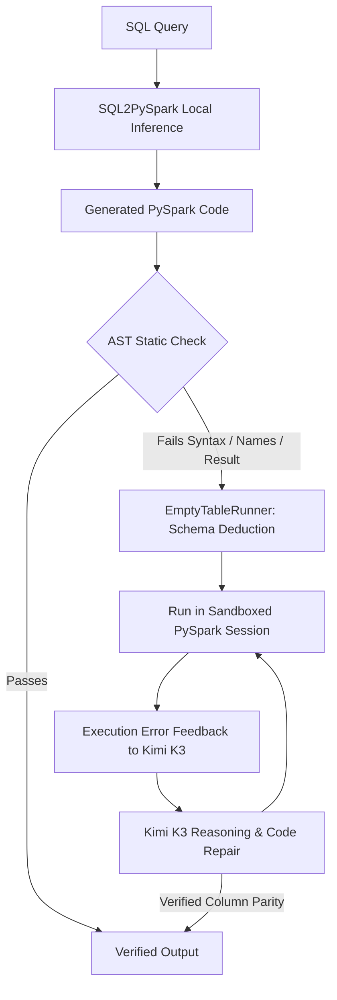

# SQL2PySpark User Manual

Welcome to **SQL2PySpark**, an execution-verified, specialized AI assistant that converts SQL queries into idiomatic, production-ready PySpark DataFrame code.

---

## 📑 Table of Contents
1. [Overview & Conventions](#1-overview--conventions)
2. [Prerequisites & Setup](#2-prerequisites--setup)
3. [Using the Streamlit Web UI](#3-using-the-streamlit-web-ui)
4. [Using the Command Line (Ollama CLI)](#4-using-the-command-line-ollama-cli)
5. [Integrating via REST API](#5-integrating-via-rest-api)
6. [SQL Feature Guide & Output Conventions](#6-sql-feature-guide--output-conventions)
7. [Automated Code Validation & Kimi K3 Repair](#7-automated-code-validation--kimi-k3-repair)
8. [Troubleshooting & FAQ](#8-troubleshooting--faq)

---

## 1. Overview & Conventions

SQL2PySpark translates complex SQL queries into clean PySpark code following standardized best practices:

- **Imports**: Standardized on `from pyspark.sql import functions as F` (and `from pyspark.sql.window import Window` when window functions are used).
- **Table References**: Any table referenced in SQL as `<table>` is accessed in PySpark as `df_<table>` (e.g., `FROM orders` $\rightarrow$ `df_orders`).
- **Result Output**: The final output DataFrame is always assigned to a variable named `result`.
- **Method Chaining & Readability**: Uses idiomatic DataFrame API calls (`.select()`, `.filter()`, `.groupBy()`, `.agg()`, `.join()`) rather than embedding raw SQL strings via `spark.sql(...)`.

---

## 2. Prerequisites & Setup

### Prerequisites
1. **Ollama**: Installed and running locally.
   - macOS: Launch via Applications or run `open -a Ollama`.
   - Linux: Run `systemctl start ollama` or `ollama serve`.
   - Verify: Run `ollama list` in your terminal to see registered models.
2. **Model Registered**: At least one `sql2pyspark` tag should be present (e.g. `sql2pyspark:latest`, `sql2pyspark:v6`).
3. **Python Environment** (for the Web UI): Python 3.10+ with Streamlit installed (`pip install -r requirements.txt`).

### Quick Start
To launch the user interface:
```bash
# Using Makefile
make app

# Or directly with Streamlit
streamlit run app.py
```
Open your browser at **`http://localhost:8501`**.

#### Public site
The app is also hosted at **https://sql2pyspark.praponb.com** (an Ubuntu server without a GPU: a typical query takes about a minute, long SQL several minutes; the Kimi K3 repair is off there). Hosting details: [docs/08-server-deployment.md](docs/08-server-deployment.md).

#### Running with Docker
If you prefer running via Docker:
```bash
docker compose up -d --build
```
The web application will be accessible at `http://localhost:8501`, connecting to the host's Ollama daemon at `http://host.docker.internal:11434`.

---

## 3. Using the Streamlit Web UI

The Web UI provides an intuitive side-by-side interface for fast query translation and validation.

```
┌─────────────────────────────────────────┬─────────────────────────────────────────┐
│              Input SQL                  │          Generated PySpark Code         │
├─────────────────────────────────────────┼─────────────────────────────────────────┤
│ SELECT                                  │ from pyspark.sql import functions as F  │
│   dept_id,                              │                                         │
│   COUNT(*) AS emp_count,                │ result = (                              │
│   AVG(salary) AS avg_sal                │     df_employees                        │
│ FROM employees                          │     .groupBy("dept_id")                 │
│ WHERE status = 'active'                 │     .agg(                               │
│ GROUP BY dept_id                        │         F.count("*").alias("emp_count"),│
│ HAVING COUNT(*) > 5                     │         F.avg("salary").alias("avg_sal")│
│ ORDER BY avg_sal DESC;                  │     )                                   │
│                                         │     .filter(F.col("emp_count") > 5)     │
│ [ Convert to PySpark ]                  │     .orderBy(F.col("avg_sal").desc())   │
│                                         │ )                                       │
│                                         │                                         │
│                                         │ [ Copy Code ]                           │
│                                         │  Code passes static checks              │
└─────────────────────────────────────────┴─────────────────────────────────────────┘
```

### Step-by-Step Instructions

1. **Enter Your SQL Query**:
   - Type or paste your SQL query into the left-hand text area.
   - Pre-populated examples are available by default to test basic functionality.
2. **Click "Convert to PySpark"**:
   - The app sends your query to the local Ollama instance.
   - The translation takes seconds (about 5–10 seconds for typical queries with the 7B `latest` model; long multi-CTE queries can take 2–4 minutes).
3. **Inspect the Output**:
   - The generated code appears in the right column with syntax highlighting.
   - Click the built-in copy icon in the upper right of the code box to copy the snippet directly to your clipboard.
4. **Review Static AST Checks**:
   - Immediately below the output, a status card displays the result of the Abstract Syntax Tree (AST) inspection:
     -  **Code passes static checks**: Python syntax is valid, no undefined variable names are referenced, and `result` is assigned.
     - ⚠️ **Check Warnings**: Alerts you if the model left a bracket open, hallucinated an undefined variable, or missed assigning `result`.

### Sidebar Options

- **Model Tag**: Change the text field in the sidebar to switch between model versions:
  - `sql2pyspark` or `sql2pyspark:latest`: Current production model (**v7**, 7B; best on every evaluation set).
  - `sql2pyspark:v6`: Previous production model (7B).
  - `sql2pyspark:v5`: Previous production model (3B, about twice as fast, slightly less accurate).
  - `sql2pyspark:v4` / `:v3`: Earlier 3B models, kept for comparison.
- **Kimi K3 Repair**: *When a check fails or the SQL is long* (default; long = over 2,000 characters), *When a check fails*, *Always* or *Off* (requires `KIMI_API_KEY` in `.env`; without it the section explains how to enable it).

---

## 4. Using the Command Line (Ollama CLI)

You can convert SQL directly from your terminal or shell scripts using Ollama's CLI.

### Interactive Mode
Launch an interactive session with the model:
```bash
ollama run sql2pyspark
```
At the prompt, request a conversion:
```text
>>> Convert SQL to PySpark:
... ```sql
... SELECT customer_id, SUM(total_amount) AS revenue
... FROM orders
... WHERE status = 'COMPLETED'
... GROUP BY customer_id;
... ```
```

### Non-Interactive / Scripting (Pipes)
Pass SQL directly via standard input or arguments:

```bash
ollama run sql2pyspark "Convert SQL to PySpark:
\`\`\`sql
SELECT p.category, AVG(p.price) AS avg_price
FROM products p
GROUP BY p.category;
\`\`\`"
```

To extract pure Python code from the response in shell scripts:
```bash
ollama run sql2pyspark "Convert SQL to PySpark:
\`\`\`sql
SELECT id, name FROM customers WHERE active = true;
\`\`\`" | sed -n '/^```python/,/^```/p' | sed '1d;$d'
```

---

## 5. Integrating via REST API

Ollama exposes a standard REST API at `http://localhost:11434/api/chat`. You can integrate SQL2PySpark into any backend, IDE extension, or CI/CD pipeline.

### Using `curl`

```bash
curl http://localhost:11434/api/chat -d '{
  "model": "sql2pyspark",
  "stream": false,
  "options": {
    "temperature": 0.2
  },
  "messages": [
    {
      "role": "user",
      "content": "Convert SQL to PySpark:\n```sql\nSELECT user_id, COUNT(*) AS logins FROM web_events WHERE event_type = '\''LOGIN'\'' GROUP BY user_id;\n```"
    }
  ]
}'
```

#### Extracting Code via `jq`
```bash
curl -s http://localhost:11434/api/chat -d '{
  "model": "sql2pyspark",
  "stream": false,
  "options": { "temperature": 0.2 },
  "messages": [{
    "role": "user",
    "content": "Convert SQL to PySpark:\n```sql\nSELECT id, name FROM departments;\n```"
  }]
}' | jq -r '.message.content'
```

### Using Python (`requests`)

```python
import json
import re
import requests


def sql_to_pyspark(sql_query: str, model: str = "sql2pyspark") -> str:
  prompt = f"Convert SQL to PySpark:\n```sql\n{sql_query.strip()}\n```"

  # For long queries (>2000 chars), set repeat_last_n to 2048 to prevent loops
  options = {"temperature": 0.2}
  if len(sql_query) > 2000:
    options["repeat_last_n"] = 2048

  response = requests.post(
      "http://localhost:11434/api/chat",
      json={
          "model": model,
          "stream": False,
          "options": options,
          "messages": [{"role": "user", "content": prompt}],
      },
      timeout=600 if len(sql_query) > 2000 else 180,
  )
  response.raise_for_status()

  content = response.json()["message"]["content"]

  # Extract the python code block
  matches = re.findall(
      r"```(?:python|pyspark|py)?\s*\n(.*?)```", content, flags=re.S
  )
  if matches:
    return max(matches, key=len).strip()
  return content.strip()


# Example invocation
sql = """
WITH ranked_sales AS (
    SELECT
        store_id,
        product_id,
        sales_amount,
        ROW_NUMBER() OVER (PARTITION BY store_id ORDER BY sales_amount DESC) as rnk
    FROM store_sales
)
SELECT store_id, product_id, sales_amount
FROM ranked_sales
WHERE rnk <= 3;
"""

pyspark_code = sql_to_pyspark(sql)
print(pyspark_code)
```

---

## 6. SQL Feature Guide & Output Conventions

SQL2PySpark supports a wide spectrum of SQL constructs:

### Supported Feature Matrix

| SQL Pattern | Example Query Construct | Translated PySpark Output |
| :--- | :--- | :--- |
| **Aggregations** | `COUNT(*)`, `AVG(x)`, `SUM(y)` | `.groupBy(...).agg(F.count("*"), F.avg("x"))` |
| **Conditional Filters** | `WHERE a > 10 AND b IS NOT NULL` | `.filter((F.col("a") > 10) & F.col("b").isNotNull())` |
| **CASE WHEN** | `CASE WHEN age >= 18 THEN 'Adult' ELSE 'Minor' END` | `F.when(F.col("age") >= 18, "Adult").otherwise("Minor")` |
| **CTEs (WITH)** | `WITH cte AS (...) SELECT ... FROM cte` | Intermediate DataFrames chained into `result` |
| **Joins** | `INNER`, `LEFT`, `RIGHT`, `FULL`, `CROSS` | `df_a.join(df_b, on=..., how="left")` |
| **Semi / Anti Joins** | `WHERE EXISTS (...)` / `WHERE NOT EXISTS (...)` | `df_a.join(df_b, on=..., how="left_semi" / "left_anti")` |
| **Null-Safe Join** | `a <=> b` or `a IS NOT DISTINCT FROM b` | `df_a.join(df_b, df_a.id.eqNullSafe(df_b.id))` |
| **Window Functions** | `ROW_NUMBER() OVER (PARTITION BY ... ORDER BY ...)` | `w = Window.partitionBy(...).orderBy(...)`<br>`F.row_number().over(w)` |
| **Window Frames** | `RANGE BETWEEN INTERVAL 1 DAY PRECEDING...` | `w.rangeBetween(-86400, 0)` or `w.rowsBetween(-5, 0)` |
| **Set Operations** | `UNION ALL`, `UNION`, `INTERSECT`, `EXCEPT` | `.unionByName()`, `.distinct()`, `.intersect()`, `.subtract()` |
| **Reshaping** | `PIVOT (SUM(v) FOR col IN ('A', 'B'))` | `.groupBy(...).pivot("col", ["A", "B"]).agg(...)` |
| **Unpivoting** | `UNPIVOT (val FOR metric IN (cpu, mem))` | `df.unpivot(ids, values, "metric", "val")` |
| **Array & Nested Data**| `EXPLODE(items)`, `LATERAL VIEW` | `.select(..., F.explode("items").alias(...))` |
| **Higher-Order Lambdas**| `TRANSFORM(arr, x -> x + 1)`, `FILTER(...)` | `F.transform("arr", lambda x: x + 1)` |

### Input Recommendations for Best Results
- **Specify Table Aliases**: When performing multi-table joins, prefixing columns with table names or aliases (e.g. `o.customer_id = c.id`) ensures unambiguous column resolution in PySpark.
- **Explicit Aggregation Aliases**: Always alias computed expressions in SQL (e.g., `COUNT(*) AS total_count`). PySpark will then cleanly name output columns.
- **Target DataFrame Names**: Assume base tables are pre-loaded as `df_<table_name>`. If your code will run on existing DataFrames, name your SQL tables accordingly.

---

## 7. Automated Code Validation & Kimi K3 Repair

For mission-critical conversions or massive multi-CTE queries (2,000+ characters), the system provides an automated verification and self-correction loop powered by Moonshot AI's **Kimi K3**.



### 1. Zero-Cost AST Static Checks
Every conversion runs through Python's `ast` parser instantly:
- Detects unclosed parentheses, missing commas, and syntax slips.
- Detects undefined variable references (such as hallucinated window identifiers like `w93`).
- Confirms that the target variable `result` is assigned.
- Flags `.unionByName()` when the SQL's `UNION` branches name their columns differently (SQL matches set-operation columns by position, so the code needs `.union()`).

### 2. Kimi K3 Repair with Sandboxed Schema Execution
When a check fails, when the SQL is long (over 2,000 characters), or when requested:
1. **What leaves your machine**: the SQL query and the generated PySpark code are sent to Moonshot AI's Kimi API; no table data is (the app has none). Kimi declares the table schemas it infers from the SQL, and [kimi_repair.py](kimi_repair.py) creates empty DataFrames with those schemas (`EmptyTableRunner`). Don't enable the repair for SQL you may not share with a third-party API.
2. **Local Spark execution**: each candidate code version runs in a local PySpark session on those empty tables, which catches wrong column names, type errors and column-order mismatches (not mistakes that only show in the data).
3. **Column Parity Check**: The tool verifies that the DataFrame's output columns match the expected projection of the SQL query.
4. **Result**: Shows the repaired code, token metrics, execution time, and repair cost (typically $0.07–$0.27 per query; with the Spark-default rules, v7's answers to the 4 real-world test queries were repaired 12/12 times on empty tables and 11/12 on sample tables over 3 runs).

### Activating Kimi K3
Create a file named `.env` in the repository root (it is gitignored, so the key never gets committed) with:
```bash
KIMI_API_KEY=your_moonshot_api_key
# optional (these are the defaults):
KIMI_BASE_URL=https://api.moonshot.ai/v1
KIMI_MODEL=kimi-k3
```
Get a key at platform.moonshot.ai (console → API keys). Keep the file private (`chmod 600 .env`).
Restart the app (`make app` or `docker compose restart app`). The repair options in the sidebar will activate automatically.

---

## 8. Troubleshooting & FAQ

### Q1: "Cannot connect to Ollama at http://localhost:11434"
- **Cause**: The Ollama background process is not running.
- **Solution**:
  - macOS: Open the Ollama application (`open -a Ollama`).
  - Terminal: Run `ollama serve`.
  - Check in browser: Visit `http://localhost:11434` (should display *"Ollama is running"*).

### Q2: "Model 'sql2pyspark' not found"
- **Cause**: The model tag has not been registered in Ollama.
- **Solution**:
  - Run `ollama list` to verify registered tags.
  - If you have exported weights, run `make export TAG=v7` or `ollama cp sql2pyspark:v7 sql2pyspark:latest`.
  - Alternatively, type an existing tag (e.g., `sql2pyspark:v6` or `sql2pyspark:v5`) in the sidebar text box.

### Q3: Why does long SQL produce repeating window definitions?
- **Cause**: Very long queries (>2,000 characters) can enter repetition loops on smaller models if the repetition penalty window is too small.
- **Solution**:
  - The Web UI automatically sets `repeat_last_n=2048` for queries over 2,000 characters.
  - If querying the Ollama API directly, pass `"repeat_last_n": 2048` in the request options payload.
  - Enable the Kimi K3 repair toggle in the sidebar to auto-repair looped queries into compact code.

### Q4: Out of Memory on 16 GB Apple Silicon Mac
- **Cause**: Running Docker Desktop, Ollama, and local model training concurrently.
- **Solution**:
  - Docker Desktop's VM allocates ~8 GB RAM. Stop Docker (`docker compose down`) before running model fine-tuning (`make train`).
  - For inference, Ollama needs about 8 GB with the 7B `latest` model (Q8_0, 4k context) and about 3.5 GB with `sql2pyspark:v5` (3B); the Streamlit app adds about 1 GB when the Kimi repair starts Spark.

---

## 🔗 Related Documentation
- [docs/INDEX.md](docs/INDEX.md) — Documentation index and navigation
- [docs/05-serving-and-streamlit-ui.md](docs/05-serving-and-streamlit-ui.md) — Deep technical serving architecture
- [docs/07-operations-runbook.md](docs/07-operations-runbook.md) — Admin & developer operations guide
- [PROJECT_DOCUMENTATION.md](PROJECT_DOCUMENTATION.md) — Complete end-to-end engineering specification
