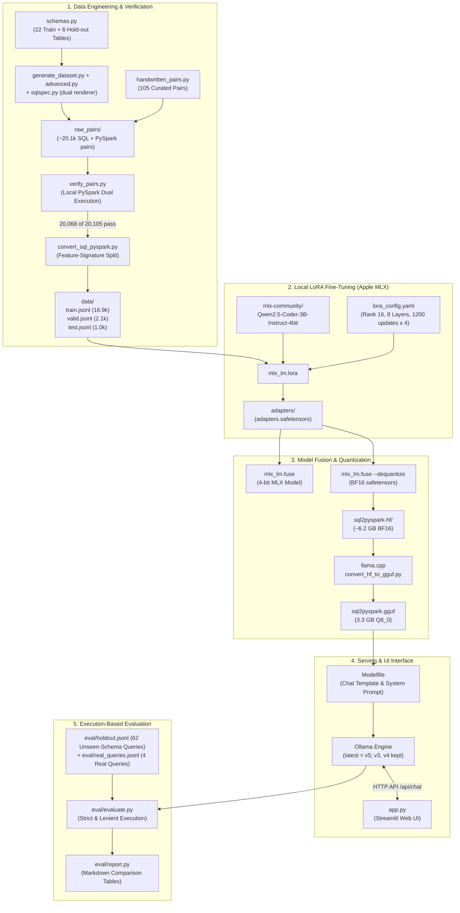

# 01 - Architecture Overview

The **SQL → PySpark Fine-Tuning Pipeline** is an end-to-end, local system developed on Apple Silicon. It trains, quantizes, packages, and serves a specialized coding language model that converts SQL statements into idiomatic Apache Spark DataFrame Python code.

---

## 🏗️ System Architecture & Workflow

The whole lifecycle—from synthetic query generation to inference in a web UI—runs offline on local hardware (developed and measured on a base Apple M2 with 16 GB).



---

## 🎯 Design Principles & Core Philosophy

### 1. Dual-Rendering by Construction (`sqlspec.py`)
Rather than translating SQL with another LLM (which can hallucinate) or with fragile regular expressions, each query is built as a tree of Python objects (expressions, predicates, window specs, relations, `SELECT`s). Each object class in `sqlspec.py` defines both a `.sql(style)` method and a `.py(ctx)` method, so both texts are rendered from the same underlying structure.

### 2. Ground-Truth Spark Execution Verification (`verify_pairs.py`)
Before any pair is used for training, it is executed in a local `pyspark.sql.SparkSession`:
$$\text{spark.sql(sql\_query)} \stackrel{?}{=} \text{exec(pyspark\_code)}$$
Both results are compared on:
- Exact column names and order
- Multiset row equivalence (row order ignored, floats rounded to 4 decimals)
- Sequence of the `ORDER BY` columns, when the query has one

Only matching pairs go into `verified.jsonl`. In the v4 dataset 20,068 of 20,105 pairs pass (the failures are mostly `CORR` dividing by zero under ANSI mode); in v3 all 15,105 passed. The v2 build had one failure, a real edge case (`NOT IN` against an empty subquery keeps NULL keys in SQL), which exposed a generator bug; v3 renders the exact semantics instead of dropping the pair.

### 3. Feature-Signature Splitting (`convert_sql_pyspark.py`)
Random row-level splitting leaks: near-identical query structures with different constants land in both train and test. Instead:
- Each query gets a **feature signature**: `family | sorted(feature_tags)`.
- Whole signatures are held out for `valid.jsonl` and `test.jsonl` (0 signatures shared with train).
- Validation loss therefore measures generalisation to unseen combinations of SQL features. (It still uses the generator's own style; the hand-written hold-out set in `eval/` is the stronger test.)

### 4. Apple Silicon Training (Apple MLX)
- Base model: `Qwen2.5-Coder-3B-Instruct-4bit`
- LoRA fine-tuning in unified memory with `mlx-lm`.
- Peak memory during training: **~9.7 GB**. That fits a 16 GB Mac, but not alongside Ollama: running an evaluation during training caused a Metal out-of-memory crash.
- v2/v3: ~1 h 50 min for 1,200 iterations of 4 short samples. v4 (samples up to 3.1k tokens): batch 2 × 2 accumulation with gradient checkpointing, ~5 h 15 min, run through `train_resumable.py` so a Metal abort ("Impacting Interactivity") resumes from the last checkpoint.

---

## 📐 Output Code Conventions (Model Target Behavior)

The model is fine-tuned to produce PySpark code that follows these conventions:

```python
from pyspark.sql import functions as F
from pyspark.sql.window import Window  # included only when window functions are used

# 1. Window definitions and other preamble come first
w = Window.partitionBy("dept_id").orderBy(F.col("salary").desc(), "id")

# 2. Input DataFrames are named df_<table>
# 3. The final DataFrame is always assigned to `result`
result = (
    df_employees
    .withColumn("rn", F.row_number().over(w))
    .filter(F.col("rn") <= 3)
    .select("id", "full_name", "dept_id", "salary")
)
```

### Key Formatting Rules:
1. **Input names**: table `table_name` is always read from `df_table_name`.
2. **Output name**: the final DataFrame is always assigned to `result`.
3. **Column order & aliases**: output columns, aliases and order match the SQL `SELECT` list one-to-one.
4. **Column references**: `F.col("name")` in expressions; plain strings for simple `.select("a", "b")` / `.groupBy("a")`; joins use `df_x.alias("a")` with `F.col("a.col")`.
5. **No bare counts**: aggregations use `.agg(F.count("*").alias("cnt"))` rather than `.count()`, so the column name matches the SQL alias.
6. **Set operations**:
   - `UNION ALL` → `.unionByName(other)` when both sides have the same column names, otherwise `.union(other)` (SQL matches columns by position)
   - `UNION` → the same call followed by `.distinct()`
   - `EXCEPT` → `.subtract(other)`
   - `INTERSECT` → `.intersect(other)`
7. **CTEs**: become named intermediate DataFrames instead of one nested expression; scalar subqueries become a value computed up front (`avg_x = df.agg(...).first()[0]`).
