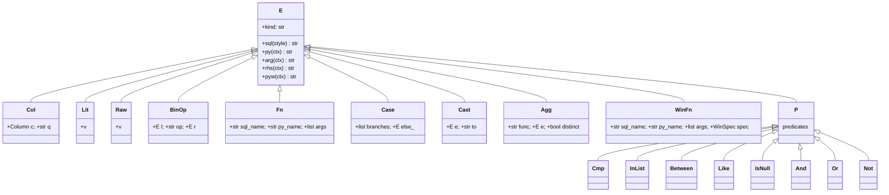

# 02 - Data Engineering & Synthesis Pipeline

The data engineering pipeline in `sql2pyspark-mlx/` generates, verifies, and packages synthetic SQL-to-PySpark training pairs. It addresses the main challenge of fine-tuning code models: **producing execution-verified, leakage-free training pairs at scale.**

---

## 📂 Pipeline Overview

The pipeline runs in three phases (`make data` runs all three):
1. **Synthesis**: compositional query generation from Python objects (`generate_dataset.py` + `sqlspec.py`) plus curated pairs (`handwritten_pairs.py`).
2. **Ground-truth verification**: local PySpark execution comparing the SQL result with the PySpark result (`verify_pairs.py`).
3. **Leakage-free splitting**: signature-based partitioning and chat formatting (`convert_sql_pyspark.py`).

---

## 1. Table Catalog & Schema Definitions (`schemas.py`)

[schemas.py](../sql2pyspark-mlx/schemas.py) defines the relational domain model for the whole dataset. It separates tables into two groups:

### A. 17 Training Tables
Used by `generate_dataset.py` and `handwritten_pairs.py`:
- **E-commerce & retail**: `customers`, `orders`, `order_items`, `products`, `suppliers`, `payments`, `shipments`, `stores`, `inventory`, `store_sales`, `subscriptions`
- **HR**: `employees`, `departments`
- **Banking**: `accounts`, `transactions`
- **Web analytics**: `sessions`, `web_events`

### B. 5 Hold-Out Tables (`holdout=True`)
Never used by the generator or the hand-written training pairs; only the evaluation set (`eval/holdout.jsonl`) uses them:
- `patients`, `doctors`, `appointments` (healthcare)
- `flights`, `bookings` (aviation)

### C. Column Types & Synthetic Data
Every table is defined with typed `Column` descriptors:
```python
@dataclass(frozen=True)
class Column:
    name: str
    kind: str              # id, fk, int, double, cat, str, date, ts, bool, array
    pool: tuple = ()       # allowed values for categorical/string/array columns
    lo: float = 0          # numeric range minimum
    hi: float = 100        # numeric range maximum
    ref: str | None = None # foreign-key target table
    nullable: bool = True
```

`make_dataframes(spark, seed=7)` builds a deterministic 40-row sample for each table (about 8% NULLs in nullable columns, a few dangling foreign keys so anti-joins and outer joins have something to find), registers each as a temp view (`createOrReplaceTempView(table.name)`), and returns them as `df_<table_name>`.

---

## 2. Dual-Rendering Expression Engine (`sqlspec.py`)

[sqlspec.py](../sql2pyspark-mlx/sqlspec.py) keeps the SQL and PySpark sides consistent. Instead of generating text with regexes or templates, it represents each query as a tree of typed objects.

Every expression inherits from base class `E` and implements:
- `.sql(style)`: renders Spark SQL according to the surface `Style`.
- `.py(ctx)`: renders the equivalent PySpark expression.



Query-level objects are not expressions: `Rel` (a table, CTE or derived table), `Join`, `Semi` (EXISTS / IN / NOT EXISTS / NOT IN, rendered as semi/anti joins in PySpark) and `Sel` (a full `SELECT` with joins, filters, grouping, HAVING, ORDER BY and LIMIT). `WinSpec` holds a window's partition, order and frame.

### Surface Styling Variance (`Style`)
To make the model robust to different SQL writing styles, `Style` randomizes non-semantic variations:
- Upper- vs. lower-case keywords (`SELECT` vs. `select`)
- Explicit vs. implicit aliases (`col AS c` vs. `col c`) and short vs. full table aliases
- `<>` vs. `!=`
- `JOIN` vs. `INNER JOIN`, `LEFT JOIN` vs. `LEFT OUTER JOIN`
- Multi-line vs. single-line layout
- Trailing semicolons, explicit `ASC`

### Preamble Management (`Ctx`)
`Ctx` collects window specifications (`w = Window.partitionBy(...)`) and scalar-subquery values, and places them before the main DataFrame chain; `render_code()` adds the imports.

---

## 3. Compositional Query Generator (`generate_dataset.py`)

[generate_dataset.py](../sql2pyspark-mlx/generate_dataset.py) builds queries from **12 families**:

| Family | SQL Pattern | PySpark Implementation |
| :--- | :--- | :--- |
| `fam_select` | `SELECT cols, exprs FROM t WHERE cond ORDER BY ... LIMIT n`, `SELECT *`, `DISTINCT` | `.filter(...).select(...).orderBy(...).limit(n)` / `.withColumn(...)` |
| `fam_agg` | `SELECT g, AGG(x) FROM t WHERE cond GROUP BY g HAVING cond`, `ROLLUP`/`CUBE` | `.filter(...).groupBy(...).agg(...).filter(...)` |
| `fam_join` | `FROM a [INNER\|LEFT\|RIGHT\|FULL] JOIN b ON ...`, chains, self-joins, composite keys | `df_a.alias("a").join(df_b.alias("b"), cond, "left").select(...)` |
| `fam_join_agg` | Joins followed by `GROUP BY` and aggregates | join chain → `.groupBy(...).agg(...)` |
| `fam_window` | `ROW_NUMBER`/`RANK`/`NTILE`/`LAG`/`LEAD`/running & moving aggregates `OVER (...)` | `w = Window...`, `F.row_number().over(w)` |
| `fam_topn` | Top-N per group via a ranked CTE or derived table | `.withColumn("rn", ...).filter(F.col("rn") <= n)` |
| `fam_cte_agg_join` | `WITH totals AS (SELECT ... GROUP BY fk) SELECT ... FROM parent JOIN totals` | named intermediate DataFrame (e.g. `customer_totals = ...`) joined into the main chain |
| `fam_cte_chain` | `WITH t1 AS (...), t2 AS (... FROM t1) SELECT ... FROM t2` | sequential named DataFrames |
| `fam_derived` | `SELECT ... FROM (SELECT ... GROUP BY ...) sub WHERE ...` | one chain: inner steps followed by the outer filter |
| `fam_subquery` | `IN`, `EXISTS`, `NOT EXISTS`, `NOT IN`, scalar and correlated subqueries | `left_semi` / `left_anti` joins, a value computed with `.first()[0]`, or a window aggregate for correlated subqueries |
| `fam_setop` | `UNION ALL`, `UNION`, `INTERSECT`, `EXCEPT` | `.unionByName()`, `.distinct()`, `.intersect()`, `.subtract()` |
| `fam_special` | `PIVOT`, `EXPLODE` / `LATERAL VIEW`, `CROSS JOIN`, window over an aggregate | `.groupBy().pivot().agg()`, `F.explode()`, `.crossJoin()`, `.withColumn(... .over(w))` after `.agg()` |

Each sample is tagged with feature tags, for example `where_cmp`, `where_like`, `where_null`, `where_or`, `case`, `fn_date`, `fn_str`, `agg_case`, `having`, `order`, `limit`, `join_left`, `window_rank`, `window_frame`, `cte`, `set_union_all`. The tags drive the split in step 6.

---

## 4. Curated Pairs (`handwritten_pairs.py`)

[handwritten_pairs.py](../sql2pyspark-mlx/handwritten_pairs.py) adds **105 hand-written pairs** (the v1 curated set, ported to the v2 conventions and schema). They cover features the generator produces rarely or never, for example:
- Modulo arithmetic (`%`) and `POWER()`
- `ORDER BY ... NULLS LAST`
- String functions (`SPLIT`, `CONCAT_WS`, `REGEXP_EXTRACT`, `REPLACE`)
- Date arithmetic (`DATEDIFF()`, `DATE_SUB()`, `ADD_MONTHS()`)
- `CROSS JOIN`, `INTERSECT`/`EXCEPT` across tables, `ROLLUP`, `CUBE`, `PIVOT`

All 105 are execution-verified and always go to the training split.

---

## 5. Spark Dual-Execution Verifier (`verify_pairs.py`)

[verify_pairs.py](../sql2pyspark-mlx/verify_pairs.py) checks every pair using a pool of worker processes (`multiprocessing`, spawn context), each with its own local `SparkSession`.

```
                    ┌───────────────────────────────┐
                    │ raw_pairs/*.sql & *.py        │
                    └───────────────┬───────────────┘
                                    │
                    ┌───────────────┴───────────────┐
                    │ Worker Pool (Checker Instance)│
                    └───────┬───────────────┬───────┘
                            │               │
             spark.sql(sql) │               │ exec(py_code)
                            ▼               ▼
                    ┌──────────────┐ ┌──────────────┐
                    │  SQL Output  │ │PySpark Output│
                    │  DataFrame   │ │  DataFrame   │
                    └───────┬──────┘ └──────┬───────┘
                            │               │
                            └───────┬───────┘
                                    ▼
                    ┌───────────────────────────────┐
                    │      compare() Verification   │
                    │ 1. Column Names Match?        │
                    │ 2. Multiset Row Values Match? │
                    │ 3. ORDER BY Keys Preserved?   │
                    └───────────────┬───────────────┘
                                    │
                       Pass ────────┴──────── Fail
                        │                      │
                        ▼                      ▼
                 verified.jsonl        verify_failures.jsonl
```

### Verification Rules:
1. **Column matching**: names and order must be identical (`s_cols == p_cols`).
2. **Multiset equivalence**: rows are normalized (numbers rounded to 4 decimals, dates ISO-formatted, NaN standardized) and compared with `Counter(map(repr, rows))`, so row order doesn't matter.
3. **Ordering**: if the query has `ORDER BY`, the sequence of the ORDER BY columns must match (rows that tie may come out in either order).

### Verification Run Results (`raw_pairs/verify_report.json`):
```json
{
  "total": 15105,
  "ok": 15104,
  "pass_rate": 0.9999,
  "ok_but_empty_result": 1683,
  "by_status": { "ok": 15104, "rows": 1 },
  "seconds": 865.7
}
```
The one failure was a `NOT IN` subquery: when the subquery returns no rows, SQL keeps rows whose key is NULL, but the generated PySpark removes them first. The pair was dropped; the same pattern may still appear in pairs whose data didn't trigger the edge case. 1,683 passing pairs return an empty result, which makes their check weaker.

---

## 6. Leakage-Free Dataset Splitting (`convert_sql_pyspark.py`)

[convert_sql_pyspark.py](../sql2pyspark-mlx/convert_sql_pyspark.py) turns `verified.jsonl` into the JSONL chat datasets.

### Signature-Based Split
The split is done by **feature signature**:
$$\text{Signature} = \text{family} \;\|\; \text{sorted}(\text{features})$$

1. Pairs are grouped by signature.
2. Whole signatures are assigned to `valid` (10%) and `test` (5%).
3. A signature is only held out if it holds at most 2% of the pairs and every one of its features keeps at least `min_train_per_feature=30` training examples.
4. All 105 hand-written pairs always go to `train`.

### Final Split Statistics (`data/split_stats.json`):
- **Verified pairs**: 15,104
- **Training set (`train.jsonl`)**: 12,743 pairs (3,299 signatures)
- **Validation set (`valid.jsonl`)**: 1,574 pairs (386 signatures)
- **Test set (`test.jsonl`)**: 787 pairs (216 signatures)
- **Signatures shared between train and valid/test**: **0**
- **Features missing from train**: **0**

`valid_meta.jsonl` / `test_meta.jsonl` keep the SQL, reference code and ORDER BY columns for execution-based evaluation.

### Chat Template Structure:
Each record uses the MLX chat format and the same prompt the Ollama runtime and `app.py` use:
```json
{
  "messages": [
    {
      "role": "system",
      "content": "You are an expert data engineer specializing in SQL and Apache Spark. Convert the provided SQL query into clean, idiomatic PySpark DataFrame code."
    },
    {
      "role": "user",
      "content": "Convert SQL to PySpark:\n```sql\nSELECT ...\n```"
    },
    {
      "role": "assistant",
      "content": "```python\nfrom pyspark.sql import functions as F\n\nresult = df_...\n```"
    }
  ]
}
```
Training samples are 210 tokens long at the median (557 max), well under `max_seq_length: 1024`.
