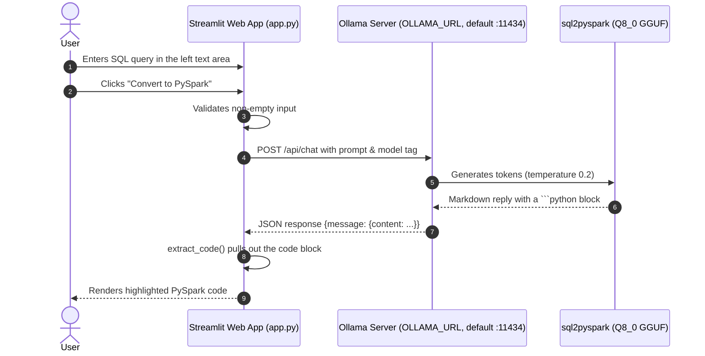

# 05 - Serving & Streamlit UI

The user-facing layer connects a local **Ollama** inference server with a small **Streamlit** web application.

---

## 🔌 Architecture & Flow



---

## 🦙 Ollama Serving Engine

The GGUF model (`sql2pyspark.gguf`) is registered in the local Ollama daemon as `sql2pyspark:v2`, and `sql2pyspark:latest` points to it; the previous model stays available as `sql2pyspark:v1`.

### Server Address
- Default: `http://localhost:11434`
- Override with the `OLLAMA_URL` environment variable (read by both `app.py` and `eval/evaluate.py`), e.g. `OLLAMA_URL=http://gpu-box:11434 make app`.

### API Endpoint
- **URL**: `$OLLAMA_URL/api/chat`
- **Method**: `POST`
- **Headers**: `Content-Type: application/json`

#### Request Payload (as sent by `app.py`):
```json
{
  "model": "sql2pyspark",
  "messages": [
    {
      "role": "user",
      "content": "Convert SQL to PySpark:\n```sql\nSELECT dept_id, COUNT(*) AS total FROM employees GROUP BY dept_id;\n```"
    }
  ],
  "stream": false,
  "options": {
    "temperature": 0.2
  }
}
```
The system prompt and `top_p 0.9` come from the Modelfile, so the app doesn't send them.

#### Response Structure (example):
```json
{
  "model": "sql2pyspark",
  "created_at": "2026-09-26T07:12:44.123456Z",
  "message": {
    "role": "assistant",
    "content": "```python\nfrom pyspark.sql import functions as F\n\nresult = df_employees.groupBy(\"dept_id\").agg(F.count(\"*\").alias(\"total\"))\n```"
  },
  "done": true
}
```

---

## 🖥️ Streamlit Frontend Application (`app.py`)

[app.py](../app.py) is a small (~100 lines) Streamlit frontend with two dependencies (`streamlit`, `requests`).

### 1. Robust Code Extraction (`extract_code`)
Models sometimes stop before closing a code fence. `extract_code()` handles both cases:
```python
def extract_code(text: str) -> str:
    """Return the longest fenced code block in the reply (or the whole reply if there is none)."""
    blocks: list[str] = re.findall(r"```(?:python|pyspark|py)?\s*\n(.*?)```", text, flags=re.S)
    if blocks:
        return max(blocks, key=len).strip()
    # unterminated fence (generation stopped before the closing ```)
    text = re.sub(r"^\s*```(?:python|pyspark|py)?\s*\n", "", text)
    return text.replace("```", "").strip()
```
`eval/evaluate.py` uses an identical copy of this function, so the UI shows the same code the evaluation scored.

### 2. Two-Column Layout
- **Left column**: text area preloaded with an example query (`COUNT(*)`, `AVG()`, `WHERE`, `GROUP BY`, `HAVING`, `ORDER BY`).
- **Right column**: generated code with syntax highlighting and Streamlit's copy button.

### 3. Model Tag Field (Sidebar)
A text field (default `sql2pyspark`, i.e. `latest`) accepts any tag from `ollama list`, for example:
- `sql2pyspark:latest` (default, currently v2)
- `sql2pyspark:v2`
- `sql2pyspark:v1` (previous model, for comparison)

### 4. Error Handling
- **Ollama unreachable**: shows `Cannot connect to Ollama at <OLLAMA_URL>. Make sure the Ollama service is running (open -a Ollama).`
- **Blank input**: shows a warning.
- **Timeout**: 120 seconds per request.

The app was checked headlessly (`streamlit.testing.v1.AppTest`) on the default query and three hold-out queries (a CTE with a join, a PIVOT, and a GROUP BY/ORDER BY). All three hold-out conversions were execution-verified as correct.

---

## 🚀 Launching the Interface

```bash
make app
# or
streamlit run app.py
```

The UI runs at **`http://localhost:8501`**. Serving it from Docker is in progress; see the [Operations Runbook](07-operations-runbook.md#-docker-work-in-progress).
