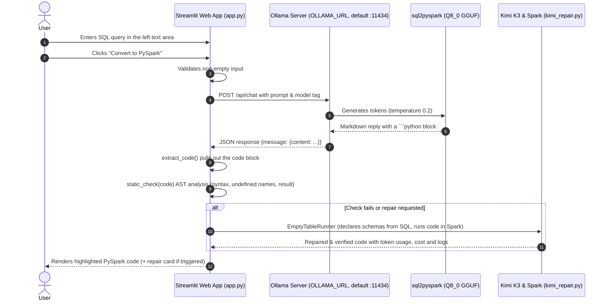

# 05 - Serving & Streamlit UI

The user-facing layer connects a local **Ollama** inference server with a small **Streamlit** web application.

---

## 🔌 Architecture & Flow



---

## 🦙 Ollama Serving Engine

Each export registers `sql2pyspark.gguf` in the local Ollama daemon under its tag. `sql2pyspark:latest` points to **q9df3-q4** (Qwen3.5-9B) on the Mac mini (`94c353738904`, since 2026-11-25 19:20 Bangkok time; `app.py` sends `"think": false` and `num_predict` 4,096 for it; v18a-q4 `03bb9f945dd4` 2026-11-15 ~12:20 → 11-25, the rollback; v15-q4 `882787d22c3c` 2026-10-09 05:50 → 11-15; v12-q4 `096519684f69` 2026-10-03 → 10-09, v11-q4 `0afa9fb8d9b0` 2026-10-02 → 10-03, v9-q4 `f19cf7096ebb` before that; the server runs v15-q4 too since 2026-10-09 06:29, v12-q4 2026-10-03 → 10-09; 5.1 GB loaded, ~8 s per hold-out query on the M2); `sql2pyspark:v9` (the same model at Q8_0) and `sql2pyspark:v8` (the previous `latest`) stay available on the Mac (v1–v7 were removed from the Mac; the server keeps v7). Ollama keeps its own copy of each tag; `sql2pyspark.gguf` on disk holds v18a (Q8_0; a Q8_0 build of q9df3 scored hold-out 59 vs. 61 and was not used) and `sql2pyspark-q4.gguf` q9df3-q4 (5.6 GB, copied 2026-11-26 from `sql2pyspark-mlx/qwen35_pilot/variants/gguf/q9df3-q4.gguf`; register it with `Modelfile.qwen35`, which has the Qwen3.5 non-thinking template; v18a-q4 before); `sql2pyspark:v10` … `:v18a-q4` are registered on the Mac mini as well.

### Server Address

- Default: `http://localhost:11434`
- Override with the `OLLAMA_URL` environment variable (read by both `app.py` and `eval/evaluate.py`), e.g. `OLLAMA_URL=http://gpu-box:11434 make app`.

### API Endpoint

- **URL**: `$OLLAMA_URL/api/chat`
- **Method**: `POST`
- **Headers**: `Content-Type: application/json`

#### Request Payload (as sent by `app.py`)

```json
{
  "model": "sql2pyspark",
  "messages": [
    {
      "role": "user",
      "content": "Convert SQL to PySpark:\n```sql\nSELECT dept_id, COUNT(*) AS total FROM employees GROUP BY dept_id;\n```"
    }
  ],
  "stream": false,
  "options": {
    "temperature": 0.2
  }
}
```

The system prompt and `top_p 0.9` come from the Modelfile, so the app doesn't send them.

#### Response Structure (example)

```json
{
  "model": "sql2pyspark",
  "created_at": "2026-09-26T07:12:44.123456Z",
  "message": {
    "role": "assistant",
    "content": "```python\nfrom pyspark.sql import functions as F\n\nresult = df_employees.groupBy(\"dept_id\").agg(F.count(\"*\").alias(\"total\"))\n```"
  },
  "done": true
}
```

---

## 🖥️ Streamlit Frontend Application (`app.py`)

[app.py](../app.py) is a streamlined (~180 lines) Streamlit frontend with support for local Ollama inference and automated Kimi K3 empty-table verification and repair.

### 1. Robust Code Extraction (`extract_code`)

Models sometimes stop before closing a code fence. `extract_code()` handles both cases:

```python
def extract_code(text: str) -> str:
    """Return the longest fenced code block in the reply (or the whole reply if there is none)."""
    blocks: list[str] = re.findall(r"```(?:python|pyspark|py)?\s*\n(.*?)```", text, flags=re.S)
    if blocks:
        return max(blocks, key=len).strip()
    # unterminated fence (generation stopped before the closing ```)
    text = re.sub(r"^\s*```(?:python|pyspark|py)?\s*\n", "", text)
    return text.replace("```", "").strip()
```

`eval/evaluate.py` and `kimi_repair.py` use an identical implementation, so the UI, evaluation, and repair agent process identical code blocks.

### 2. Two-Column Layout

- **Left column**: text area preloaded with an example query (`COUNT(*)`, `AVG()`, `WHERE`, `GROUP BY`, `HAVING`, `ORDER BY`).
- **Right column**: generated code with syntax highlighting, AST check status, and Streamlit's copy button.

### 3. Model Tag Field (Sidebar)

A text field (default `sql2pyspark`, i.e. `latest`) accepts any tag from `ollama list`, for example:

- `sql2pyspark:latest` (default; on the Mac **v12-q4** since 2026-10-03, on the server v12-q4 since 2026-10-03 16:48). **v9-q4**: v9 as Q4_K_M, 4.7 GB; "mirror" window style, 87/100 on the complex test vs. v8's 60, one hold-out query weaker; see [Evaluation](04-evaluation-and-benchmarking.md))
- `sql2pyspark:v9` (the same model at Q8_0, 8.1 GB)
- `sql2pyspark:v10-q4` / `sql2pyspark:v10` (candidate, 2026-10-01: bare `IN` / `NOT IN` 49/50 vs. 11/50, no `real001` loop, v4 hold-out 18 vs. 21; see [Evaluation](04-evaluation-and-benchmarking.md#-v10-results-2026-10-01))
- `sql2pyspark:v13-q4` / `sql2pyspark:v13` (2026-10-03, **not used**: a regression on correlated scalar subqueries and the hold-out; kept only as a record)
- `sql2pyspark:q9df3-q4` (2026-11-25, Qwen3.5-9B weight merge of q9d / q9f / q9f2, **`latest` since 2026-11-25 19:20**: hold-out 61, fixed 147, complex 93, complex-shift 131/150; needs `think: false`, which `app.py` sends; see [Evaluation](04-evaluation-and-benchmarking.md#-qwen35-9b-q9e--q9df3-2026-11-22--11-25--q9df3-q4-promoted)). Also kept: `q9e-q4` (+ `-q8`, `-q6`, `-q4im`, `-avg-q4`), `q9d-q8`, `q9de-q4`, `q9f-q4`, `q9fe-q4`, `q9df-q4`, `q9df2-q4`, `q9df2h-q4`, `q9df3b-q4` (not promoted).
- `sql2pyspark:v18a-q4` / `sql2pyspark:v18a` (2026-11-15, `latest` 2026-11-15 ~12:20 → 11-25, **the rollback target**: hold-out 61, fixed 145, complex 88, complex-shift 126/150; see [Evaluation](04-evaluation-and-benchmarking.md#-v18-and-qwen35-results-2026-11-15--11-18)); `sql2pyspark:v18avg-q4` / `:v18avg` (the v15 + v17 adapter average, not promoted)
- `sql2pyspark:q9a-q4` (2026-11-18, Qwen3.5-9B fresh QLoRA run q9a: complex 93 but below v18a-q4 on 5 sets; **not promoted**; needs `think: false`; see [qwen35_pilot](../sql2pyspark-mlx/qwen35_pilot/README.md))
- `sql2pyspark:q9b-q4`, `:q9c-q4`, `:q9d-q4` (2026-11-21/22, Qwen3.5-9B polish rounds on top of q9a: q9d has the fewest failures and name slips but hold-out 59 vs. 61; **not promoted**; need `think: false`; see [Evaluation](04-evaluation-and-benchmarking.md#-qwen35-9b-polish-rounds-q9b-q9d-2026-11-20--11-22--not-promoted))
- `sql2pyspark:v15-q4` / `sql2pyspark:v15` (2026-10-08, `latest` on the Mac 2026-10-09 05:50 → 11-15 and on the server 2026-10-09 → 11-08; hold-out 60, classic 97/97, complex 89, schema-shift 189/200, v4 hold-out 20; see [Evaluation](04-evaluation-and-benchmarking.md#-v15-results-2026-10-08))
- `sql2pyspark:v17-q4` / `sql2pyspark:v17` (2026-11-08, the first Mac mini run, **not promoted**: hold-out 61, complex-shift 116, fewest failures, but fixed 142 and complex 85 vs. v15-q4 145 / 89; see [Evaluation](04-evaluation-and-benchmarking.md#-v17-results-2026-11-08--not-promoted))
- `sql2pyspark:q35m6g-q4` (2026-11-11, Qwen3.5-9B run 8, the best Qwen3.5 model; **not used**; needs `think: false`; see [qwen35_pilot](../sql2pyspark-mlx/qwen35_pilot/README.md)). Also kept: `q35-pilot-q4`, `base-q35-q4`, `base-coder7b-q4` from the 2026-10-09 pilot.
- `sql2pyspark:v16-q4` / `sql2pyspark:v16` (2026-10-09, **not promoted**: complex pairs on unseen domains 128/150 vs. v15-q4 110, but hold-out 58, complex 84, v11 / v12 held-out 261 / 216; see [Evaluation](04-evaluation-and-benchmarking.md#-v16-results-2026-10-09--not-promoted))
- `sql2pyspark:v14-q4` / `sql2pyspark:v14` / `sql2pyspark:v14-c2400-q4` (2026-10-07, **not promoted**: correlated + uncorrelated scalar subqueries right, classic `subquery` 17/17, fixed test 145, but name slips on unseen tables, hold-out 58 / v4 18; see [Evaluation](04-evaluation-and-benchmarking.md#-v14-results-2026-10-07--not-promoted))
- `sql2pyspark:v12-q4` / `sql2pyspark:v12` (`latest` on the Mac and the server 2026-10-03 → 10-09: v11 with the `OR` slip fixed — fixed-test `OR` queries 11/12, held-out `or_where` 97/100 — and the subquery gains kept; classic 95/97, complex 83/100; see [Evaluation](04-evaluation-and-benchmarking.md#-v12-results-2026-10-03))
- `sql2pyspark:v11-q4` / `sql2pyspark:v11` (`latest` on the Mac 2026-10-02 → 10-03; correlated subqueries 283/300 held-out vs. 130, `IN` / `NOT IN` 50/50, v4 hold-out 21; but an `OR` can become two `.filter()` calls, classic 93/97; see [Evaluation](04-evaluation-and-benchmarking.md#-v11-results-2026-10-02))
- `sql2pyspark:v8` (the previous default, kept for rollback)

The older tags `v1`–`v6` were removed on 2026-09-30; see [Model Training & Export](03-model-training-and-export.md) to rebuild one (e.g. the faster 3B v5).

### Generation settings

`app.py` sends `temperature` 0.2. For SQL longer than 2,000 characters, `generation_options()` also sets `repeat_last_n` to 2,048 (Ollama's default: 64) and the request timeout rises from 180 s to 600 s: on long multi-CTE queries the model otherwise repeats window definitions until the token limit. Short queries are unaffected (see the repetition-penalty experiment in [Evaluation](04-evaluation-and-benchmarking.md)). With v6 (7B) this setting no longer stops the `real001` loop (identical 92-window reply); the static check flags the resulting syntax error, and the Kimi K3 repair fixed the same kind of looping answer from v5 in both repair tests.

### Kimi repair (optional)

With `KIMI_API_KEY` set (in `.env`; Docker passes it in), the app checks and repairs the model's answer with Kimi (Moonshot AI): `KIMI_MODEL`, default **`kimi-k3.1-pro`** since 2026-11-08 (before: `kimi-k3`, which produced the results quoted below). The UI labels follow the model (`kr.display_name()`), and `PRICES` holds the per-token rates for the cost shown after each repair. Spark's Python workers use the app's own interpreter (`PYSPARK_PYTHON`), so a different `python3` on `PATH` doesn't break the checks. The shared logic is in `kimi_repair.py`:

1. **Static check** (free, instant, `static_check()`):
   - Syntax errors
   - Names that are used but never defined (e.g. `w93` from a repetition loop)
   - Missing `result` assignment
   - Positional set operation mismatches (`setop_check()`): flags `.unionByName()` when a `UNION`/`INTERSECT`/`EXCEPT` has branches with differently named columns (e.g. `holdout031`)
   - Unqualified join columns (`join_check()`): flags `F.col("id")` without an alias prefix in a join between aliased DataFrames (preventing `AMBIGUOUS_REFERENCE` runtime exceptions such as in `holdout024`)
2. **Repair** (`repair()`): Kimi K3 gets the SQL and the model's code, plus one tool, `run_pyspark`. There is no data, so the tool (`EmptyTableRunner`) runs the code on **empty tables whose schemas Kimi declares from the SQL**. It reports syntax, name, column and type errors, analyzes the SQL itself on the same tables and compares its output columns with `result`'s. Mistakes that only show in the data are not caught, and `.sql(...)` is refused. At most 5 runs per repair.
3. **UI**: the sidebar's *Kimi K3 repair* switch runs the repair *When a check fails or the SQL is long* (default since 2026-09-29; long = over 2,000 characters), *When a check fails*, *Always* or *Off*. Long SQL is repaired even when the static check passes because the model's errors there often only show when the code runs (v7's `real002` and `real004`: an invalid method and a missing column). A *Check and repair with Kimi K3* button runs it on demand. The repaired code is shown below the model's, marked as verified when Kimi's last check ran exactly that code with matching columns, with the checks, tokens and cost. Without a key the section is off.

On the 4 real-world queries this mode fixes 3 (0/4 before; $0.79 in total, 1.5-6.5 minutes per query); see [Evaluation](04-evaluation-and-benchmarking.md#-agent-repair-loop-with-kimi-k3-2026-09-28). Spark starts once per app process (`get_spark()`, `local[1]`, 1 GB).

### 4. Error Handling

- **Ollama unreachable**: shows `Cannot connect to Ollama at <OLLAMA_URL>. Make sure the Ollama service is running.` (the hint `open -a Ollama` was dropped on 2026-11-26: on the Mac mini the LaunchDaemon serves Ollama, and the app must not be opened).
- **Very long SQL** (since 2026-11-26): above `VERY_LONG_SQL_CHARS` = 12,000 characters (~3,200 tokens at `CHARS_PER_TOKEN` 3.7) a warning appears under the input before converting. The reply needs ~1.1-1.2 tokens per input token, so it can't fit in `MAX_REPLY_TOKENS` (the `num_predict` cap of 4,096) and would be cut off after 3-4 minutes of the single Ollama slot; the warning suggests converting one CTE or subquery at a time. Triggered by two capped site requests on 2026-11-26 (08:17 and 08:47 Bangkok time, the same 26,138-token input).
- **Cut-off reply**: when Ollama returns `done_reason: "length"`, the app shows a notice that the code is incomplete and skips the automatic Kimi repair (costly on huge SQL); the *Check and repair* button stays.
- **Blank input**: shows a warning.
- **Timeout**: 180 seconds per request (600 seconds for SQL longer than 2,000 characters; raised from 120/300 s for the slower 7B model, which needed up to ~270 s on the real-world queries).

The app was checked headlessly with the v2 model (`streamlit.testing.v1.AppTest`) on the default query and three hold-out queries (a CTE with a join, a PIVOT, and a GROUP BY/ORDER BY). All three hold-out conversions were execution-verified as correct.

---

## 🚀 Launching the Interface

```bash
make app
# or
streamlit run app.py
```

The UI runs at **`http://localhost:8501`**.

### From Docker

```bash
docker compose up -d --build     # app container on http://localhost:8501, model served by the host's Ollama
docker compose down
```

The image includes Java 17 and PySpark for the Kimi K3 checks (2.1 GB; 0.8 GB before). `docker-compose.yml` reads `.env` if it exists (`env_file`, optional), so the key never goes into the image. The `app` container reaches the native Ollama on the host through `OLLAMA_URL=http://host.docker.internal:11434` (the default in `docker-compose.yml`) and reports healthy once Streamlit is up. Keep Ollama native on a Mac: containers can't use the Apple GPU. See the [Operations Runbook](07-operations-runbook.md#-docker) for the other profiles.

### On a Linux server

The public site <https://sql2pyspark.praponb.com> runs on the Mac mini M6 since 2026-11-08: LaunchDaemons for Ollama, the app (127.0.0.1:8502, so `make app` keeps 8501) and Cloudflare Tunnel `sql2pyspark`, behind a Cloudflare Access login; see [deploy/macmini](../deploy/macmini/README.md). Before, an Ubuntu server served it with native Ollama and the app as a systemd service behind a Cloudflare Tunnel and the same Cloudflare Access login (allowed emails only; Cloudflare account or emailed one-time code); see [Server Deployment](08-server-deployment.md).
