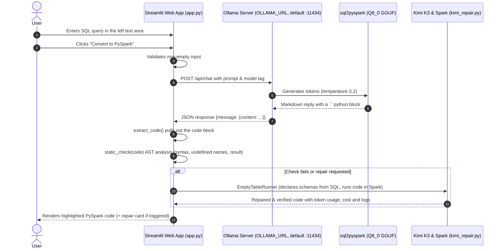

# 05 - Serving & Streamlit UI

The user-facing layer connects a local **Ollama** inference server with a small **Streamlit** web application.

---

## 🔌 Architecture & Flow



---

## 🦙 Ollama Serving Engine

Each export registers `sql2pyspark.gguf` in the local Ollama daemon under its tag. `sql2pyspark:latest` points to **v7** (the 7B model continued from v6, since 2026-09-29; 7.9 GB loaded, ~9 s per hold-out query vs. ~4 s for the 3B); `sql2pyspark:v6` (the previous `latest`, 7B), `sql2pyspark:v5` (3B), `sql2pyspark:v4`, `sql2pyspark:v3`, `sql2pyspark:v2` and `sql2pyspark:v1` stay available. Ollama keeps its own copy of each tag; `sql2pyspark.gguf` on disk holds the last export (v7, 8.1 GB).

### Server Address
- Default: `http://localhost:11434`
- Override with the `OLLAMA_URL` environment variable (read by both `app.py` and `eval/evaluate.py`), e.g. `OLLAMA_URL=http://gpu-box:11434 make app`.

### API Endpoint
- **URL**: `$OLLAMA_URL/api/chat`
- **Method**: `POST`
- **Headers**: `Content-Type: application/json`

#### Request Payload (as sent by `app.py`):
```json
{
  "model": "sql2pyspark",
  "messages": [
    {
      "role": "user",
      "content": "Convert SQL to PySpark:\n```sql\nSELECT dept_id, COUNT(*) AS total FROM employees GROUP BY dept_id;\n```"
    }
  ],
  "stream": false,
  "options": {
    "temperature": 0.2
  }
}
```
The system prompt and `top_p 0.9` come from the Modelfile, so the app doesn't send them.

#### Response Structure (example):
```json
{
  "model": "sql2pyspark",
  "created_at": "2026-09-26T07:12:44.123456Z",
  "message": {
    "role": "assistant",
    "content": "```python\nfrom pyspark.sql import functions as F\n\nresult = df_employees.groupBy(\"dept_id\").agg(F.count(\"*\").alias(\"total\"))\n```"
  },
  "done": true
}
```

---

## 🖥️ Streamlit Frontend Application (`app.py`)

[app.py](../app.py) is a streamlined (~180 lines) Streamlit frontend with support for local Ollama inference and automated Kimi K3 empty-table verification and repair.

### 1. Robust Code Extraction (`extract_code`)
Models sometimes stop before closing a code fence. `extract_code()` handles both cases:
```python
def extract_code(text: str) -> str:
    """Return the longest fenced code block in the reply (or the whole reply if there is none)."""
    blocks: list[str] = re.findall(r"```(?:python|pyspark|py)?\s*\n(.*?)```", text, flags=re.S)
    if blocks:
        return max(blocks, key=len).strip()
    # unterminated fence (generation stopped before the closing ```)
    text = re.sub(r"^\s*```(?:python|pyspark|py)?\s*\n", "", text)
    return text.replace("```", "").strip()
```
`eval/evaluate.py` and `kimi_repair.py` use an identical implementation, so the UI, evaluation, and repair agent process identical code blocks.

### 2. Two-Column Layout
- **Left column**: text area preloaded with an example query (`COUNT(*)`, `AVG()`, `WHERE`, `GROUP BY`, `HAVING`, `ORDER BY`).
- **Right column**: generated code with syntax highlighting, AST check status, and Streamlit's copy button.

### 3. Model Tag Field (Sidebar)
A text field (default `sql2pyspark`, i.e. `latest`) accepts any tag from `ollama list`, for example:
- `sql2pyspark:latest` (default, currently **v7**; 7B, best on every evaluation set; see [Evaluation](04-evaluation-and-benchmarking.md))
- `sql2pyspark:v6` (previous production model, 7B)
- `sql2pyspark:v5` (previous stable 3B model, about twice as fast)
- `sql2pyspark:v4` (better at the v4 features: GROUPING SETS, PIVOT/UNPIVOT, nested data, ...; see [Evaluation](04-evaluation-and-benchmarking.md))
- `sql2pyspark:v3` (previous stable production model)
- `sql2pyspark:v2` (previous model, for comparison)
- `sql2pyspark:v1` (template-based first model)

### Generation settings
`app.py` sends `temperature` 0.2. For SQL longer than 2,000 characters, `generation_options()` also sets `repeat_last_n` to 2,048 (Ollama's default: 64) and the request timeout rises from 180 s to 600 s: on long multi-CTE queries the model otherwise repeats window definitions until the token limit. Short queries are unaffected (see the repetition-penalty experiment in [Evaluation](04-evaluation-and-benchmarking.md)). With v6 (7B) this setting no longer stops the `real001` loop (identical 92-window reply); the static check flags the resulting syntax error, and the Kimi K3 repair fixed the same kind of looping answer from v5 in both repair tests.

### Kimi K3 repair (optional)
With `KIMI_API_KEY` set (in `.env`; Docker passes it in), the app checks and repairs the model's answer with Kimi K3 (Moonshot AI). The shared logic is in `kimi_repair.py`:

1. **Static check** (free, instant, `static_check()`): syntax, names that are used but never defined (e.g. `w93` from a repetition loop) and a missing `result`. It flags 3 of v5's 4 failures on the real-world queries. Since 2026-09-29 it also gets the SQL and flags `.unionByName()` when a `UNION`/`INTERSECT`/`EXCEPT` has branches with differently named columns (`setop_check()`): SQL matches them by position, so `.union()` is needed. This is the `holdout031` failure of every model from v3 to v7; the rule flags it for all five and none of 383 correct `unionByName` pairs in the dataset or any correct stored answer.
2. **Repair** (`repair()`): Kimi K3 gets the SQL and the model's code, plus one tool, `run_pyspark`. There is no data, so the tool (`EmptyTableRunner`) runs the code on **empty tables whose schemas Kimi declares from the SQL**. It reports syntax, name, column and type errors, analyzes the SQL itself on the same tables and compares its output columns with `result`'s. Mistakes that only show in the data are not caught, and `.sql(...)` is refused. At most 5 runs per repair.
3. **UI**: the sidebar's *Kimi K3 repair* switch runs the repair *When a check fails or the SQL is long* (default since 2026-09-29; long = over 2,000 characters), *When a check fails*, *Always* or *Off*. Long SQL is repaired even when the static check passes because the model's errors there often only show when the code runs (v7's `real002` and `real004`: an invalid method and a missing column). A *Check and repair with Kimi K3* button runs it on demand. The repaired code is shown below the model's, marked as verified when Kimi's last check ran exactly that code with matching columns, with the checks, tokens and cost. Without a key the section is off.

On the 4 real-world queries this mode fixes 3 (0/4 before; $0.79 in total, 1.5-6.5 minutes per query); see [Evaluation](04-evaluation-and-benchmarking.md#-agent-repair-loop-with-kimi-k3-2026-09-28). Spark starts once per app process (`get_spark()`, `local[1]`, 1 GB).

### 4. Error Handling
- **Ollama unreachable**: shows `Cannot connect to Ollama at <OLLAMA_URL>. Make sure the Ollama service is running (open -a Ollama).`
- **Blank input**: shows a warning.
- **Timeout**: 180 seconds per request (600 seconds for SQL longer than 2,000 characters; raised from 120/300 s for the slower 7B model, which needed up to ~270 s on the real-world queries).

The app was checked headlessly with the v2 model (`streamlit.testing.v1.AppTest`) on the default query and three hold-out queries (a CTE with a join, a PIVOT, and a GROUP BY/ORDER BY). All three hold-out conversions were execution-verified as correct.

---

## 🚀 Launching the Interface

```bash
make app
# or
streamlit run app.py
```

The UI runs at **`http://localhost:8501`**.

### From Docker
```bash
docker compose up -d --build     # app container on http://localhost:8501, model served by the host's Ollama
docker compose down
```
The image includes Java 17 and PySpark for the Kimi K3 checks (2.1 GB; 0.8 GB before). `docker-compose.yml` reads `.env` if it exists (`env_file`, optional), so the key never goes into the image. The `app` container reaches the native Ollama on the host through `OLLAMA_URL=http://host.docker.internal:11434` (the default in `docker-compose.yml`) and reports healthy once Streamlit is up. Keep Ollama native on a Mac: containers can't use the Apple GPU. See the [Operations Runbook](07-operations-runbook.md#-docker) for the other profiles.

### On a Linux server
The public site https://sql2pyspark.praponb.com runs on an Ubuntu server with native Ollama and the app as a systemd service behind a Cloudflare Tunnel; see [Server Deployment](08-server-deployment.md).
